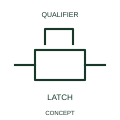

# Two-way latching device

This form identifies the publisher's two-way latching-device arrangement.

[Canonical reference](https://eloragrid.ai/symbols/iec-two-way-latching-device) · [Structured record](../entries/iec-two-way-latching-device.json) · [All references](README.md)

Updated: 2026-10-27. Drawing use: Schematic. Reference families: IEC, Manufacturer.

Graphical convention: IEC. Two-way latching device.

## What it represents

This form identifies the publisher's two-way latching-device arrangement. A two-way latch represents retention associated with more than one movement or position relationship. The electrical contacts operated by that mechanism can still have their own independent state table.
Document the positions that are retained and how the mechanism changes between them. Device tagging connects the latch representation to the operated contacts or actuator.

## How to read it

- Document the positions retained by the latch and the changeover action.
- Two-way retention does not imply a two-way electrical contact arrangement.

## Drawing checklist

- Identify the associated device, circuit or diagram boundary.
- Document the positions retained by the latch and the changeover action.
- Cross-reference the equipment data, terminal mapping or operating-state legend needed to interpret the form.

## Important distinction

Two-way retention does not imply a two-way electrical contact arrangement.

## Facts

- Reference scope: Specific public IEC-context family form
- Publisher reference token: Q1020603 (Autodesk token; not a verified IEC database ID)
- Information added: Document the positions retained by the latch and the changeover action.
- Preview: Independent educational concept; consult the publisher and applicable standard for the exact graphic

## Public references

- [Autodesk IEC-60617 preview: Latching-device qualifiers](https://help.autodesk.com/cloudhelp/2021/ENU/AutoCAD-Electrical/files/GUID-9FC7824E-1A3B-4B47-B157-590CB8AE62FC.htm) — Autodesk. Official public publisher family name and reference context; vendor identifiers and graphics are distinct from licensed IEC database content.

## Related references

- [Relay coil](relay-coil.md)
- [Normally open contact](normally-open-contact.md)

Original educational concept geometry, CC BY 4.0. Unitless; not a certified standards glyph or manufacturer footprint.

Elora-authored explanations are CC BY 4.0. Linked standards and manufacturer material retain their own rights. Confirm project requirements using primary sources.
