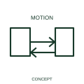

# Two-way rotary-motion qualifier

This qualifier identifies a mechanism capable of rotary movement in either direction.

[Canonical reference](https://eloragrid.ai/symbols/iec-two-way-rotary-motion-qualifier) · [Structured record](../entries/iec-two-way-rotary-motion-qualifier.json) · [All references](README.md)

Updated: 2026-10-27. Drawing use: Schematic. Reference families: IEC, Manufacturer.

Graphical convention: IEC. Two-way rotary-motion qualifier.

## What it represents

This qualifier identifies a mechanism capable of rotary movement in either direction. Both directions of rotation are part of the represented mechanism. The reversal can be controlled electrically or mechanically, depending on the selected equipment.
Identify the two command paths and any permitted transition between them. Interlocks and feedback should be shown as actual circuit relationships rather than inferred from the double arrow.

## How to read it

- Cross-reference forward/reverse commands and any position limits.
- Reversible rotation and unrestricted continuous rotation are different attributes.

## Drawing checklist

- Identify the associated device, circuit or diagram boundary.
- Cross-reference forward/reverse commands and any position limits.
- Cross-reference the equipment data, terminal mapping or operating-state legend needed to interpret the form.

## Important distinction

Reversible rotation and unrestricted continuous rotation are different attributes.

## Facts

- Reference scope: Specific public IEC-context family form
- Publisher reference token: Q020404 (Autodesk token; not a verified IEC database ID)
- Information added: Cross-reference forward/reverse commands and any position limits.
- Preview: Independent educational concept; consult the publisher and applicable standard for the exact graphic

## Public references

- [Autodesk IEC-60617 preview: Rotary force and motion qualifiers](https://help.autodesk.com/cloudhelp/2021/ENU/AutoCAD-Electrical/files/GUID-A2633343-7A99-4CAF-BF09-F108A4714D55.htm) — Autodesk. Official public publisher family name and reference context; vendor identifiers and graphics are distinct from licensed IEC database content.

## Related references

- [Relay coil](relay-coil.md)
- [Normally open contact](normally-open-contact.md)

Original educational concept geometry, CC BY 4.0. Unitless; not a certified standards glyph or manufacturer footprint.

Elora-authored explanations are CC BY 4.0. Linked standards and manufacturer material retain their own rights. Confirm project requirements using primary sources.
