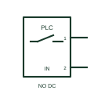

# IEC two-wire PLC point: in, 1st point, 2 wires

Two-wire PLC point form: IN, 1st Point, 2 Wires.

[Canonical reference](https://eloragrid.ai/symbols/iec-two-wire-plc-point-in-1st-point-2-wires) · [Structured record](../entries/iec-two-wire-plc-point-in-1st-point-2-wires.json) · [All references](README.md)

Updated: 2026-10-28. Drawing use: Schematic. Reference families: IEC, Manufacturer.

Graphical convention: IEC. IN, 1st Point, 2 Wires.

## What it represents

A two-wire PLC point form shows two terminal connections associated with a controller input or output point. The symbol is an interface reference, and the module data must establish whether the connection is digital, analogue, isolated or part of a shared common group. This entry identifies the in, 1st point, 2 wires form in the publisher's IEC-context family.
When tracing a field device to a PLC terminal strip, identify the rack, module, channel and both terminal numbers. Follow the common or return conductor as carefully as the signal conductor so a technician can reconcile the schematic with the module wiring sheet. The two-connection interface must be read with the load and supply arrangement. Leakage current and minimum load can matter where a powered device is connected in series with an input.
Two drawn wires do not prove that the field device is loop-powered or that a point can supply current. Electrical type, polarity, common grouping and internal protection depend on the selected module and cannot be inferred from the outline.

## How to read it

- The two-connection interface must be read with the load and supply arrangement. Leakage current and minimum load can matter where a powered device is connected in series with an input.
- Two drawn wires do not prove that the field device is loop-powered or that a point can supply current. Electrical type, polarity, common grouping and internal protection depend on the selected module and cannot be inferred from the outline.

## Drawing checklist

- Identify controller, module and channel address.
- Label both terminals and the shared common where used.
- Reference signal type, polarity and module wiring documentation.

## Important distinction

This entry adds the in, 1st point, 2 wires detail to the broader two-wire PLC point family. Two drawn wires do not prove that the field device is loop-powered or that a point can supply current. Electrical type, polarity, common grouping and internal protection depend on the selected module and cannot be inferred from the outline.

## Facts

- Drawing form: IN, 1st Point, 2 Wires
- Public vendor block names: PLCIOI2T / PLCIOI2TV. Autodesk identifiers, not standards database IDs.
- Drawing purpose: two-wire PLC point
- Graphic scope: Independently authored educational illustration; not certified standard geometry, a terminal pinout or a product footprint.

## Public references

- [PLC input and output point symbols](https://help.autodesk.com/cloudhelp/2021/ENU/AutoCAD-Electrical/files/GUID-16A484BE-F73C-4612-8D12-E760E981C4E9.htm) — Autodesk. Public PLC I/O table explicitly lists PLCIOI2T / PLCIOI2TV with this operating or connection form. Vendor graphics are linked, not copied.

## Related references

- [PLC digital input](plc-digital-input.md)
- [PLC transistor output](plc-transistor-output.md)
- [PLC analog input](plc-analog-input.md)

Original educational concept geometry, CC BY 4.0. Unitless; not a certified standards glyph or manufacturer footprint.

Elora-authored explanations are CC BY 4.0. Linked standards and manufacturer material retain their own rights. Confirm project requirements using primary sources.
