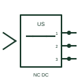

# IEC ultrasonic proximity sensor: normally closed 3 wire with connector

Ultrasonic proximity sensor form: Normally Closed 3 Wire with connector.

[Canonical reference](https://eloragrid.ai/symbols/iec-ultrasonic-proximity-sensor-normally-closed-3-wire-with-connector) · [Structured record](../entries/iec-ultrasonic-proximity-sensor-normally-closed-3-wire-with-connector.json) · [All references](README.md)

Updated: 2026-10-28. Drawing use: Schematic. Reference families: IEC, Manufacturer.

Graphical convention: IEC. Normally Closed 3 Wire with connector.

## What it represents

An ultrasonic proximity sensor uses sound above the audible range to detect a target or measure a return echo. This entry identifies the normally closed 3 wire with connector form in the publisher's IEC-context family.
A container-presence input can switch when the target enters the configured sensing window. The normally-closed designation starts with a conducting output or closed contact in the documented reference condition; operation changes that state. The three-wire form distinguishes supply, return and switching output. Confirm sourcing or sinking operation from the actual sensor circuit before connecting it to an input.
The connector variant adds a separable field interface. Keep the mating connector designation, pin numbers and cable-core mapping visible at that boundary. Blind zone, target angle and environmental effects remain device-specific. The symbol alone does not state the operating distance or switching threshold.

## How to read it

- The normally-closed designation starts with a conducting output or closed contact in the documented reference condition; operation changes that state.
- The three-wire form distinguishes supply, return and switching output. Confirm sourcing or sinking operation from the actual sensor circuit before connecting it to an input.
- The connector variant adds a separable field interface. Keep the mating connector designation, pin numbers and cable-core mapping visible at that boundary.
- Blind zone, target angle and environmental effects remain device-specific. The symbol alone does not state the operating distance or switching threshold.

## Drawing checklist

- Identify the target, sensing mode and expected normal condition.
- Label supply, output and connector pins from the actual device diagram.
- Reference output circuit type, operating range and controller input.

## Important distinction

This entry adds the normally closed 3 wire with connector detail to the broader ultrasonic proximity sensor family. Blind zone, target angle and environmental effects remain device-specific. The symbol alone does not state the operating distance or switching threshold.

## Facts

- Drawing form: Normally Closed 3 Wire with connector
- Public vendor block names: HPX12U3C / VPX12U3C. Autodesk identifiers, not standards database IDs.
- Drawing purpose: ultrasonic proximity sensor
- Graphic scope: Independently authored educational illustration; not certified standard geometry, a terminal pinout or a product footprint.

## Public references

- [Autodesk IEC-60617 preview: Ultrasonic switch forms](https://help.autodesk.com/cloudhelp/2021/ENU/AutoCAD-Electrical/files/GUID-06552B8C-FF75-458B-8761-548C5BCED3AA.htm) — Autodesk. Public Ultrasonic Switches table explicitly lists HPX12U3C / VPX12U3C with this operating or connection form. Vendor graphics are linked, not copied.

## Related references

- [Ultrasonic proximity switch](iec-ultrasonic-proximity-switch.md)
- [PLC digital input](plc-digital-input.md)
- [Terminal connection](terminal.md)

Original educational concept geometry, CC BY 4.0. Unitless; not a certified standards glyph or manufacturer footprint.

Elora-authored explanations are CC BY 4.0. Linked standards and manufacturer material retain their own rights. Confirm project requirements using primary sources.
