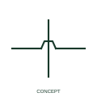

# Unconnected conductor crossing

An unconnected crossing shows conductors passing across each other in the drawing without an electrical junction.

[Canonical reference](https://eloragrid.ai/symbols/iec-unconnected-conductor-crossing) · [Structured record](../entries/iec-unconnected-conductor-crossing.json) · [All references](README.md)

Updated: 2026-10-27. Drawing use: Schematic. Reference families: Manufacturer.

## What it represents

An unconnected crossing shows conductors passing across each other in the drawing without an electrical junction. The wires overlap in the two-dimensional page layout but remain distinct circuits. A gap or bridge/loop makes that distinction visible where the selected drawing convention uses one.
Check both the displayed graphic and the CAD network topology. A crossing must not acquire an unintended junction when drawing segments are moved or edited.

## How to read it

- Apply the selected gap or loop convention consistently and check that no connection node is created.
- A gap or bridge is a drafting convention, not a physical cable crossover dimension.

## Drawing checklist

- Identify the associated device, circuit or diagram boundary.
- Apply the selected gap or loop convention consistently and check that no connection node is created.
- Cross-reference the equipment data, terminal mapping or operating-state legend needed to interpret the form.

## Important distinction

A gap or bridge is a drafting convention, not a physical cable crossover dimension.

## Facts

- Reference scope: Publisher drafting annotation / connectivity convention
- Documentation scope: Wire insertion and connectivity behaviour; no publisher block identifier or IEC database ID is asserted.
- Information added: Apply the selected gap or loop convention consistently and check that no connection node is created.
- Preview: Independent educational concept; consult the publisher and applicable standard for the exact graphic

## Public references

- [Wire connection dots, crossing gaps and loops](https://help.autodesk.com/cloudhelp/2020/ENU/AutoCAD-Electrical/files/GUID-936BB8A9-9C01-4AC6-B833-CB97700A7203.htm) — Autodesk. Official public publisher family name and reference context; vendor identifiers and graphics are distinct from licensed IEC database content.

## Related references

- [Terminal connection](terminal.md)
- [Busbar](busbar.md)

Original educational concept geometry, CC BY 4.0. Unitless; not a certified standards glyph or manufacturer footprint.

Elora-authored explanations are CC BY 4.0. Linked standards and manufacturer material retain their own rights. Confirm project requirements using primary sources.
