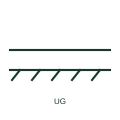

# Underground cable

A cable route marked as buried in the ground, distinguishing direct-buried or ducted sections from overhead lines.

[Canonical reference](https://eloragrid.ai/symbols/iec-underground-cable) · [Structured record](../entries/iec-underground-cable.json) · [All references](README.md)

Updated: 2026-10-28. Drawing use: SLD, GA. Reference families: IEC.

Graphical convention: IEC. Underground cable route form.

## What it represents

The underground cable form marks a circuit section that is buried, either directly in soil or in buried ducts. Network diagrams use it to separate cable sections from overhead sections, since cables have higher capacitance, lower reactance and are generally not suited to repeated auto-reclose onto a fault.
The mark does not show burial depth, duct arrangement, bedding or the thermal resistivity assumed for rating. Those appear on trench sections and the cable schedule. Joints along the route are separate symbols, and a reader should expect them on long sections even if the single-line diagram omits them.

## How to read it

- Check trench sections for depth and grouping with other cables.
- Look for joint bay locations on long routes.

## Drawing checklist

- Reference the cable type and route length.
- Show joints and sealing ends at their locations.
- Link to the trench or duct-bank section drawing.

## Important distinction

An underground cable is buried; a conductor in conduit may be above ground and carries different derating.

## Facts

- Graphic cue: Cable line with ground hatch or buried marks below it
- Rating input: Soil thermal resistivity and depth of burial
- Preview: Original educational illustration; consult the publisher and applicable standard for the exact graphic

## Public references

- [IEC-60617 symbol preview directory](https://help.autodesk.com/cloudhelp/2021/ENU/AutoCAD-Electrical/files/GUID-7871E6EF-24D5-467E-9B74-321FEDC9DFDA.htm) — Autodesk. Public directory of IEC-oriented symbol families.
- [Elastimold underground cable accessories](https://www.abb.com/global/en/areas/electrification/medium-voltage/cable-accessories-connectors/underground/elastimold/underground) — ABB. Manufacturer context for underground cable accessories.

## Related references

- [Overhead line](iec-overhead-line.md)
- [Cable straight-through joint](iec-cable-straight-through-joint.md)
- [Cable duct bank](ga-cable-duct-bank.md)

Original educational concept geometry, CC BY 4.0. Unitless; not a certified standards glyph or manufacturer footprint.

Elora-authored explanations are CC BY 4.0. Linked standards and manufacturer material retain their own rights. Confirm project requirements using primary sources.
