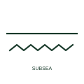

# Underwater cable

A cable section marked as laid under water, such as a river crossing, offshore export cable or lake crossing.

[Canonical reference](https://eloragrid.ai/symbols/iec-underwater-cable) · [Structured record](../entries/iec-underwater-cable.json) · [All references](README.md)

Updated: 2026-10-28. Drawing use: SLD, GA. Reference families: IEC.

Graphical convention: IEC. Underwater cable route form.

## What it represents

The underwater cable form identifies a section laid on or beneath a water bed. It appears on offshore wind export and array diagrams, island interconnectors and river crossings. The mark is a route indicator, so it sits on the cable line rather than replacing it.
Submarine cables usually have armour, longer lengths and different charging current from land cables, but the symbol carries none of that information. Transition joints at the landfall and the cable schedule supply those details. Where reactive compensation is fitted to a long submarine section, it appears as separate reactor symbols.

## How to read it

- Locate the landfall transition joints at each end.
- Check whether shunt compensation is shown for long sections.

## Drawing checklist

- Identify cable type and armour.
- Mark landfall transition points.
- Reference route survey and length.

## Important distinction

An underwater cable is laid in or under water; an underground cable is buried on land.

## Facts

- Graphic cue: Cable line above wave marks
- Typical use: Offshore export cables and water crossings
- Preview: Original educational illustration; consult the publisher and applicable standard for the exact graphic

## Public references

- [IEC-60617 symbol preview directory](https://help.autodesk.com/cloudhelp/2021/ENU/AutoCAD-Electrical/files/GUID-7871E6EF-24D5-467E-9B74-321FEDC9DFDA.htm) — Autodesk. Public directory of IEC-oriented symbol families.
- [Elastimold underground cable accessories](https://www.abb.com/global/en/areas/electrification/medium-voltage/cable-accessories-connectors/underground/elastimold/underground) — ABB. Manufacturer context for cable accessories at transitions.

## Related references

- [Underground cable](iec-underground-cable.md)
- [Cable transition joint](iec-cable-transition-joint.md)
- [Reactor](reactor.md)

Original educational concept geometry, CC BY 4.0. Unitless; not a certified standards glyph or manufacturer footprint.

Elora-authored explanations are CC BY 4.0. Linked standards and manufacturer material retain their own rights. Confirm project requirements using primary sources.
