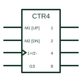

# IEC up/down counter

IEC counter whose mode inputs select counting up with + or down with -, drawn with M dependency.

[Canonical reference](https://eloragrid.ai/symbols/iec-up-down-counter) · [Structured record](../entries/iec-up-down-counter.json) · [All references](README.md)

Updated: 2026-10-28. Drawing use: Schematic. Reference families: IEC, Manufacturer.

Graphical convention: IEC. CTRm element with M dependency selecting count up (+) and count down (-).

## What it represents

An up/down counter is shown with a CTR qualifier and a clock input labelled with both counting directions, for example 2+ and 1- under mode control. A direction input produces M1 and M2 modes, so the same clock counts up in one mode and down in the other. Load and enable functions use further dependency labels.
Typical applications include position tracking from pulse inputs, reversible totalising and digital set-point adjustment. The drawing should identify the direction source and whether direction may change while clock pulses are present.
The symbol does not indicate how overflow or underflow is signalled beyond any CT= outputs shown. Check ripple clock or max/min outputs on the device.

## How to read it

- Find the mode input that selects direction.
- Check CT outputs for terminal counts in each direction.

## Drawing checklist

- Show both + and - functions with their mode numbers.
- Label the direction input clearly.
- Show cascade outputs for multi-stage counters.

## Important distinction

A single-direction CTR counter shows only + on its clock.

## Facts

- Direction notation: + (up) and - (down) under M dependency
- Example device: Synchronous 4-bit up/down binary counter
- Artwork scope: Original educational illustration; consult the applicable standard and the selected device documentation for the exact graphic

## Public references

- [Overview of IEEE Standard 91-1984: explanation of logic symbols (SDYZ001A)](https://www.ti.com/lit/ml/sdyz001a/sdyz001a.pdf) — Texas Instruments. Counting up and down inputs and M dependency.
- [SN74HC191 synchronous 4-bit up/down binary counter](https://www.ti.com/lit/ds/symlink/sn74hc191.pdf) — Texas Instruments. Manufacturer up/down counter documentation.

## Related references

- [IEC mode dependency (M)](iec-mode-dependency-m.md)
- [IEC synchronous binary counter (CTRm)](iec-synchronous-binary-counter.md)
- [Synchronous binary counter](synchronous-binary-counter.md)

Original educational concept geometry, CC BY 4.0. Unitless; not a certified standards glyph or manufacturer footprint.

Elora-authored explanations are CC BY 4.0. Linked standards and manufacturer material retain their own rights. Confirm project requirements using primary sources.
