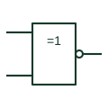

# IEC exclusive-NOR gate (rectangular form)

IEC =1 box with a negated output, giving the two-input equivalence or exclusive-NOR function.

[Canonical reference](https://eloragrid.ai/symbols/iec-xnor-gate) · [Structured record](../entries/iec-xnor-gate.json) · [All references](README.md)

Updated: 2026-10-28. Drawing use: Schematic. Reference families: IEC, Manufacturer.

Graphical convention: IEC. =1 element with output negation.

## What it represents

An IEC exclusive-NOR is commonly drawn as the =1 element with a negation circle at its output. For two inputs, the output is active when both inputs are in the same state, which is why the function is also called equivalence. Some drawings instead use the = logic-identity qualifier, which gives the same two-input result.
Equivalence checks appear where two redundant channels must agree, for example dual-channel position switches or duplicated sensor inputs. The drawing should make clear whether disagreement produces an alarm, a trip, or only a log entry, because the gate itself only produces the comparison.
The symbol does not tell you how long a disagreement may persist before action. That tolerance is a separate timing element or a setting in the implementing device.

## How to read it

- Check whether the sheet uses =1 with negation or the = identity qualifier; both mean equivalence for two inputs.
- Trace the output to see what action follows a mismatch.

## Drawing checklist

- Choose one convention for equivalence and use it consistently.
- Limit to two inputs unless the identity function is intended.
- Show the mismatch timing element separately.

## Important distinction

The = identity element extends to many inputs as all-the-same; a negated =1 with three inputs means not exactly one active.

## Facts

- Qualifier: =1 with output negation
- Alternative: = (logic identity) for two inputs
- Artwork scope: Original educational illustration; consult the applicable standard and the selected device documentation for the exact graphic

## Public references

- [Overview of IEEE Standard 91-1984: explanation of logic symbols (SDYZ001A)](https://www.ti.com/lit/ml/sdyz001a/sdyz001a.pdf) — Texas Instruments. Defines =1, = and output negation.
- [SN74HC266 — XNOR gate logic](https://www.ti.com/lit/ds/symlink/sn74hc266.pdf) — Texas Instruments. Manufacturer exclusive-NOR documentation.

## Related references

- [Exclusive-NOR gate](logic-xnor-gate.md)
- [IEC exclusive-OR gate (rectangular form)](iec-xor-gate.md)
- [IEC logic identity element](iec-logic-identity-element.md)

Original educational concept geometry, CC BY 4.0. Unitless; not a certified standards glyph or manufacturer footprint.

Elora-authored explanations are CC BY 4.0. Linked standards and manufacturer material retain their own rights. Confirm project requirements using primary sources.
