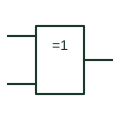

# IEC exclusive-OR gate (rectangular form)

Rectangular element marked =1: the output is active when one and only one input is active.

[Canonical reference](https://eloragrid.ai/symbols/iec-xor-gate) · [Structured record](../entries/iec-xor-gate.json) · [All references](README.md)

Updated: 2026-10-28. Drawing use: Schematic. Reference families: IEC, Manufacturer.

Graphical convention: IEC. Rectangular outline with the =1 qualifier.

## What it represents

The =1 qualifier defines an exclusive-OR in the strict IEC sense: exactly one input must be active for the output to be active. For a two-input element this matches the familiar XOR truth table. For more than two inputs it is not the same as a cascaded parity function, which IEC writes as 2k+1.
On control drawings the =1 element appears in discrepancy checks, such as comparing a commanded position with a feedback contact, and in change-detection logic. The drafter should keep the element at two inputs unless the one-and-only-one meaning is truly intended.
The qualifier does not indicate timing tolerance. Discrepancy logic normally needs a delay element after the =1 box so that the alarm ignores normal transit time; that delay is a separate symbol.

## How to read it

- For three or more inputs, read =1 as exactly one active, not odd parity.
- Look for a following delay element in discrepancy logic.

## Drawing checklist

- Use =1 only where exactly-one behaviour is intended.
- Use 2k+1 instead when odd parity is meant.
- Show any discrepancy delay as its own element.

## Important distinction

The 2k+1 odd-parity element gives the same result for two inputs but a different result for three or more.

## Facts

- Qualifier: =1 (one and only one input active)
- Multi-input caution: Not equivalent to odd parity above two inputs
- Artwork scope: Original educational illustration; consult the applicable standard and the selected device documentation for the exact graphic

## Public references

- [Overview of IEEE Standard 91-1984: explanation of logic symbols (SDYZ001A)](https://www.ti.com/lit/ml/sdyz001a/sdyz001a.pdf) — Texas Instruments. Defines =1 and distinguishes it from the 2k+1 parity qualifier.
- [SN74HC86 — XOR gate logic](https://www.ti.com/lit/ds/symlink/sn74hc86.pdf) — Texas Instruments. Manufacturer exclusive-OR documentation.

## Related references

- [Exclusive-OR gate](logic-xor-gate.md)
- [IEC odd-parity element](iec-odd-parity-element.md)
- [IEC exclusive-NOR gate (rectangular form)](iec-xnor-gate.md)

Original educational concept geometry, CC BY 4.0. Unitless; not a certified standards glyph or manufacturer footprint.

Elora-authored explanations are CC BY 4.0. Linked standards and manufacturer material retain their own rights. Confirm project requirements using primary sources.
