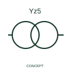

# Yz5 transformer connection reference

This reference identifies the publisher's Yz5 transformer connection form with star/zigzag winding topology.

[Canonical reference](https://eloragrid.ai/symbols/iec-yz5-transformer-connection-reference) · [Structured record](../entries/iec-yz5-transformer-connection-reference.json) · [All references](README.md)

Updated: 2026-10-27. Drawing use: SLD, Schematic. Reference families: IEC, Manufacturer.

Graphical convention: IEC. Yz5 transformer connection reference.

## What it represents

Yz5 combines an HV-side star winding designation with an LV-side zigzag designation and clock group 5. The letters describe connection topology; the final number identifies the phase relationship recorded with the transformer connection diagram. It is different from the voltage ratio or the number of terminals.
A drafter should preserve the full Yz5 designation across the SLD, transformer schedule and protection references. Two devices with the same winding letters but a different clock number are not the same connection reference. Check the selected transformer terminal diagram and the protection application documentation; the concept preview does not specify polarity tests, parallel-operation suitability or relay settings.

## How to read it

- Preserve the full group notation and verify the terminal/phase relationship in the selected transformer diagram.
- The clock-group suffix is different from a voltage ratio, power rating or physical terminal number.

## Drawing checklist

- Identify the associated device, circuit or diagram boundary.
- Preserve the full group notation and verify the terminal/phase relationship in the selected transformer diagram.
- Cross-reference the equipment data, terminal mapping or operating-state legend needed to interpret the form.

## Important distinction

The clock-group suffix is different from a voltage ratio, power rating or physical terminal number.

## Facts

- Reference scope: Specific public IEC-context family form
- Publisher reference token: HXF1T28 (Autodesk token; not a verified IEC database ID)
- Information added: Preserve the full group notation and verify the terminal/phase relationship in the selected transformer diagram.
- Preview: Independent educational concept; consult the publisher and applicable standard for the exact graphic
- HV winding topology: star
- LV winding topology: zigzag
- Clock-group label: 5

## Public references

- [AutoCAD Electrical: Three-phase transformer connections](https://help.autodesk.com/cloudhelp/2021/ENU/AutoCAD-Electrical/files/GUID-EB13DB13-01EE-4541-BED7-19B9001BE8FC.htm) — Autodesk. Official public publisher family name and reference context; vendor identifiers and graphics are distinct from licensed IEC database content.
- [Transformer vector-group interpretation in protection application](https://techdoc.relays.protection-control.abb/r/SSC600-and-SSC600-SW-Technical-Manual/1.5/en-US/TR2PTDF-Operation-principle?contentId=_tVeRElk4P5wHpFgF2sYvw) — ABB. Manufacturer application context explains why winding type and clock number must be kept distinct in transformer protection documentation. No relay settings are prescribed here.

## Related references

- [Power transformer](power-transformer.md)
- [Voltage transformer](voltage-transformer.md)

Original educational concept geometry, CC BY 4.0. Unitless; not a certified standards glyph or manufacturer footprint.

Elora-authored explanations are CC BY 4.0. Linked standards and manufacturer material retain their own rights. Confirm project requirements using primary sources.
