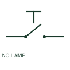

# Illuminated normally-open pushbutton

An illuminated NO pushbutton combines a manual normally-open contact function with an indication lamp.

[Canonical reference](https://eloragrid.ai/symbols/illuminated-normally-open-pushbutton) · [Structured record](../entries/illuminated-normally-open-pushbutton.json) · [All references](README.md)

Updated: 2026-10-27. Drawing use: Schematic. Reference families: IEC, Manufacturer.

## What it represents

An illuminated NO pushbutton combines a manual normally-open contact function with an indication lamp. The lamp circuit is drawn or referenced separately because its indication need not follow the contact state.

## How to read it

- Trace the lamp supply independently from the pushbutton contact circuit.
- The preview is an original explanation of this function. Match the actual drawing convention to its legend and the selected equipment documentation.

## Drawing checklist

- Identify contact terminals
- Identify lamp supply and colour
- State the indicated condition

## Important distinction

An illuminated actuator does not make its contact a lamp-test contact.

## Facts

- Drawing role: Manual operation
- Representation scope: Functional concept; not an official standard graphic or a product footprint
- Public vendor block reference: HPB11S75, VPB11S75 (Autodesk identifiers; not IEC symbol numbers)
- Identifier status: The short label is a functional lookup label, not an assigned IEC or IEEE symbol number. Any separately listed Autodesk code is a verified vendor block name.

## Public references

- [AutoCAD Electrical: Illuminated push buttons](https://help.autodesk.com/cloudhelp/2021/ENU/AutoCAD-Electrical/files/GUID-7B13B543-97A4-4A7E-8D08-49386A153A33.htm) — Autodesk. Public documentation of this equipment function or named vendor variant; the illustration is independently authored and is not the source graphic.

## Related references

- [Normally open pushbutton](pushbutton-no.md)
- [Normally closed pushbutton](pushbutton-nc.md)

Original educational concept geometry, CC BY 4.0. Unitless; not a certified standards glyph or manufacturer footprint.

Elora-authored explanations are CC BY 4.0. Linked standards and manufacturer material retain their own rights. Confirm project requirements using primary sources.
