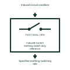

# Induced-current earthing-switch duty reference

Identifies an earthing application with its separately specified induced-current switching duty.

[Canonical reference](https://eloragrid.ai/symbols/induced-current-earthing-switch-duty-reference) · [Structured record](../entries/induced-current-earthing-switch-duty-reference.json) · [All references](README.md)

Updated: 2026-11-03. Drawing use: Schematic. Reference families: Manufacturer.

Representation: functional-block; installation focus: switchyards.
Induced circuit condition
Specified earthing switching role

## What it represents

Identifies an earthing application with its separately specified induced-current switching duty. Disconnector and earthing references identify different mechanical constructions and connection duties within a yard. The primary diagram shows which conductors are joined or earthed; the equipment drawing explains how its contacts and supports move.
In a switchyard bay, a bus selector can use a different physical construction from a line disconnector. Each device still needs an identified operating mechanism, position indication and interlocking interface. For this reference, the drawing identifies “Induced circuit condition” at the input and “Specified earthing switching role” at the output. The duty requires an explicitly rated device.
The construction name does not establish load-breaking capability, short-circuit making duty or operating permission. Verify these properties in the selected equipment data and the station interlocking scheme. The functional block is an independent explanation of this named application. Equipment-specific ratings, terminal connections and operating conditions must be established in the project documentation.

## How to read it

- Start at the named input: Induced circuit condition. Identify its source device or document and the state represented on the drawing.
- Follow the named output: Specified earthing switching role. Cross-reference its destination and separate the command from confirmation that the equipment responded.
- The duty requires an explicitly rated device.
- The construction name does not establish load-breaking capability, short-circuit making duty or operating permission. Verify these properties in the selected equipment data and the station interlocking scheme.

## Drawing checklist

- Label the source and connection reference for induced circuit condition.
- Identify the destination and defined state of specified earthing switching role.
- Record the equipment or control-document revision supporting this functional block.
- Check this application limit in the project design: The duty requires an explicitly rated device.

## Important distinction

The duty requires an explicitly rated device. This reference describes the named application; it does not establish a new IEC graphical symbol, an ANSI device-function number or an exact manufacturer connection diagram.

## Facts

- Representation: Functional block
- Installation focus: Switchyards
- Input / boundary: Induced circuit condition
- Output / connection: Specified earthing switching role
- Lookup label: IEDR is a library lookup label, not a standard device designation.

## Public references

- [Disconnectors and earthing switches](https://www.siemens-energy.com/global/en/home/products-services/product-offerings/disconnectors-earthing-switches.html) — Siemens Energy. Public technical context for disconnector and earthing applications. Disconnector construction, earthing switches and operating mechanisms. The application text and educational graphic are independently authored; the publisher does not certify this representation.

## Related references

- [Disconnector](disconnector.md)
- [Earthing switch](earthing-switch.md)
- [Fast earthing-switch functional reference](fast-earthing-switch-functional-reference.md)

Original educational concept geometry, CC BY 4.0. Unitless; not a certified standards glyph or manufacturer footprint.

Elora-authored explanations are CC BY 4.0. Linked standards and manufacturer material retain their own rights. Confirm project requirements using primary sources.
