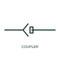

# Inline cable coupler

A connector joining two cables without either half being mounted on equipment, such as an extension lead coupling.

[Canonical reference](https://eloragrid.ai/symbols/inline-cable-coupler) · [Structured record](../entries/inline-cable-coupler.json) · [All references](README.md)

Updated: 2026-10-28. Drawing use: Schematic. Reference families: IEC, IEEE / ANSI.

## What it represents

An inline coupler joins two free cables, with neither half fixed to a panel or device. Typical uses are extension leads, portable equipment feeds and sensor cables with a disconnect point partway along the run. Drawings show both halves floating on the cable line, sometimes with a note that the coupling is located in a particular area.
Because the coupler is free, its location is not fixed by the equipment, so the drawing should state where it is. The symbol does not show ingress protection, latching or whether the coupling may be separated under load. For power couplers, the live side should be the socket half so exposed pins are not energised.

## How to read it

- Identify which side is energised and confirm it is the socket half.
- Look for a location note for the coupler.

## Drawing checklist

- Show which half is on the supply side.
- State IP rating where outdoors.
- Locate the coupler on the layout.

## Important distinction

An inline coupler joins two free cables; a panel plug and socket has one half fixed to equipment.

## Facts

- Graphic cue: Plug and socket halves on a cable line with no panel outline
- Safety practice: Supply side on the socket half
- Preview: Original educational illustration; consult the publisher and applicable standard for the exact graphic

## Public references

- [AutoCAD Electrical: Connectors](https://help.autodesk.com/cloudhelp/2021/ENU/AutoCAD-Electrical/files/GUID-7175D293-9F4C-485C-8E2D-DE684820D53B.htm) — Autodesk. Public IEC-oriented preview of plug and jack connector forms.
- [Autodesk IEEE Symbol Preview — Connectors - No Wirenumber Changes](https://help.autodesk.com/cloudhelp/2021/ENU/AutoCAD-Electrical/files/GUID-0B14FEAB-110A-4DD3-884E-0A2F8F9E76F7.htm) — Autodesk. Public IEEE-oriented preview of connector forms.

## Related references

- [Plug and socket connector pair](plug-and-socket-connector-pair.md)
- [Connector plug half](connector-plug-half.md)
- [Connector socket half](connector-socket-half.md)

Original educational concept geometry, CC BY 4.0. Unitless; not a certified standards glyph or manufacturer footprint.

Elora-authored explanations are CC BY 4.0. Linked standards and manufacturer material retain their own rights. Confirm project requirements using primary sources.
