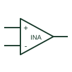

# Instrumentation amplifier

Amplifies a differential input signal using an instrumentation-amplifier input and gain arrangement.

[Canonical reference](https://eloragrid.ai/symbols/instrumentation-amplifier) · [Structured record](../entries/instrumentation-amplifier.json) · [All references](README.md)

Updated: 2026-10-27. Drawing use: Schematic. Reference families: Manufacturer.

## What it represents

Amplifies a differential input signal using an instrumentation-amplifier input and gain arrangement.
On a schematic, identify the two measurement inputs, gain-setting terminals and output reference and trace the conditioned measurement signal and receiving converter. Keep the component tag and signal/reference names consistent across the control drawing, terminal schedule and device documentation.
An instrumentation amplifier and a basic difference amplifier have different input and gain arrangements; the selected device defines their capabilities.
Terminal letters describe electrical roles, not package pin numbers. Check the selected public datasheet for the actual pin assignment, polarity and any internally connected terminals before completing the drawing.

## How to read it

- Identify the two measurement inputs, gain-setting terminals and output reference.
- Trace the conditioned measurement signal and receiving converter.

## Drawing checklist

- Label the two measurement inputs, gain-setting terminals and output reference.
- Cross-reference the conditioned measurement signal and receiving converter.
- Add the selected device or circuit documentation revision, power/reference connections and project signal convention.

## Important distinction

An instrumentation amplifier and a basic difference amplifier have different input and gain arrangements; the selected device defines their capabilities.

## Facts

- Common schematic mnemonic: INA — descriptive only; project/device documentation defines reference designations.
- Terminal / interface focus: The two measurement inputs, gain-setting terminals and output reference
- Artwork scope: Original educational component glyph; not a certified standard graphic or package pinout.

## Public references

- [AD620 — instrumentation amplification](https://www.analog.com/en/products/ad620.html) — Analog Devices. Public primary manufacturer documentation establishes the component function or circuit/topology relationship. Preview geometry and drafting explanations are independently authored.

## Related references

- [Difference amplifier](difference-amplifier.md)
- [PLC input / output](plc-io.md)

Original educational concept geometry, CC BY 4.0. Unitless; not a certified standards glyph or manufacturer footprint.

Elora-authored explanations are CC BY 4.0. Linked standards and manufacturer material retain their own rights. Confirm project requirements using primary sources.
