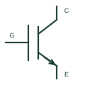

# Insulated-gate bipolar transistor

A power transistor combining insulated-gate control with a bipolar collector-emitter conduction structure.

[Canonical reference](https://eloragrid.ai/symbols/insulated-gate-bipolar-transistor) · [Structured record](../entries/insulated-gate-bipolar-transistor.json) · [All references](README.md)

Updated: 2026-10-27. Drawing use: Schematic. Reference families: Manufacturer.

## What it represents

A power transistor combining insulated-gate control with a bipolar collector-emitter conduction structure.
On a schematic, identify the gate drive, collector/emitter and any separate emitter-sense connection and trace the converter switching leg and driver return. Keep the component tag and signal/reference names consistent across the control drawing, terminal schedule and device documentation.
An IGBT is not a MOSFET with renamed pins; reverse conduction and antiparallel-diode arrangements depend on the selected device.
Terminal letters describe electrical roles, not package pin numbers. Check the selected public datasheet for the actual pin assignment, polarity and any internally connected terminals before completing the drawing.

## How to read it

- Identify the gate drive, collector/emitter and any separate emitter-sense connection.
- Trace the converter switching leg and driver return.

## Drawing checklist

- Label the gate drive, collector/emitter and any separate emitter-sense connection.
- Cross-reference the converter switching leg and driver return.
- Add the selected device or circuit documentation revision, power/reference connections and project signal convention.

## Important distinction

An IGBT is not a MOSFET with renamed pins; reverse conduction and antiparallel-diode arrangements depend on the selected device.

## Facts

- Common schematic mnemonic: IGBT — descriptive only; project/device documentation defines reference designations.
- Terminal / interface focus: The gate drive, collector/emitter and any separate emitter-sense connection
- Artwork scope: Original educational component glyph; not a certified standard graphic or package pinout.

## Public references

- [IGBT device families](https://www.infineon.com/products/power/igbt) — Infineon Technologies. Public primary manufacturer documentation establishes the component function or circuit/topology relationship. Preview geometry and drafting explanations are independently authored.

## Related references

- [N-channel enhancement MOSFET](n-channel-enhancement-mosfet.md)
- [Diode](diode.md)

Original educational concept geometry, CC BY 4.0. Unitless; not a certified standards glyph or manufacturer footprint.

Elora-authored explanations are CC BY 4.0. Linked standards and manufacturer material retain their own rights. Confirm project requirements using primary sources.
