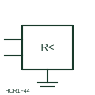

# Insulation monitoring relay

Relay that continuously checks insulation resistance of an unearthed (IT) system to earth and alarms on a first fault.

[Canonical reference](https://eloragrid.ai/symbols/insulation-monitoring-relay) · [Structured record](../entries/insulation-monitoring-relay.json) · [All references](README.md)

Updated: 2026-10-28. Drawing use: Schematic, SLD. Reference families: IEC, Manufacturer.

## What it represents

An insulation monitoring relay is connected between the conductors of an unearthed (IT) system and earth, and injects a measuring signal to determine insulation resistance. It warns when insulation falls below its setting so a first fault can be located before a second fault causes a trip.
The symbol shows the device and its connections but not the measuring method, which matters on systems with drives or large DC components. Only one insulation monitor should normally be active on a galvanically connected system, so the drawing should show any disconnection or interlock between parallel systems.

## How to read it

- Check that only one monitor is active on each connected IT system.
- Identify alarm outputs and test button wiring.

## Drawing checklist

- Show system and earth connections
- State alarm thresholds
- Reference interlock between parallel monitors

## Important distinction

An insulation monitoring relay measures insulation resistance of an unearthed system; a residual current monitor measures leakage current in an earthed system.

## Facts

- Measured quantity: Insulation resistance to earth
- Publisher reference token: HCR1F44 (Autodesk identifier; not an IEC database ID)
- Preview: Independent educational concept; consult the publisher and applicable standard for the exact graphic

## Public references

- [AutoCAD Electrical: Miscellaneous monitoring relays](https://help.autodesk.com/cloudhelp/2021/ENU/AutoCAD-Electrical/files/GUID-31F4CF79-F8E0-4E5A-8C51-4D71640ACDB8.htm) — Autodesk. Public AutoCAD Electrical relay listing that names the Insulating Relay block; the illustration is independently drawn.
- [IEC graphical symbols for diagrams](https://tc3.iec.ch/tc-activity/graphical-symbols-for-diagrams/) — IEC. IEC context for graphical symbols used in diagrams; no IEC graphic is reproduced.

## Related references

- [Insulation-failure indication](iec-insulation-failure-indication.md)
- [Residual current monitor](residual-current-monitor.md)
- [Earth-fault voltage relay](earth-fault-voltage-relay.md)

Original educational concept geometry, CC BY 4.0. Unitless; not a certified standards glyph or manufacturer footprint.

Elora-authored explanations are CC BY 4.0. Linked standards and manufacturer material retain their own rights. Confirm project requirements using primary sources.
