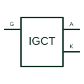

# Integrated gate-commutated thyristor

A high-power thyristor device operated with an integrated gate-unit arrangement for controlled switching.

[Canonical reference](https://eloragrid.ai/symbols/integrated-gate-commutated-thyristor) · [Structured record](../entries/integrated-gate-commutated-thyristor.json) · [All references](README.md)

Updated: 2026-10-27. Drawing use: Schematic. Reference families: Manufacturer.

## What it represents

A high-power thyristor device operated with an integrated gate-unit arrangement for controlled switching.
On a schematic, identify the anode/cathode power connections and associated gate unit and trace the converter leg and gate-unit supply/control interfaces. Keep the component tag and signal/reference names consistent across the control drawing, terminal schedule and device documentation.
An IGCT includes a specific gate-drive arrangement; its abbreviation is not interchangeable with a generic SCR or GTO.
The preview is an independently drawn educational functional reference. Add the selected component’s actual power pins, terminal numbers, timing or analogue reference details when producing a construction drawing.

## How to read it

- Identify the anode/cathode power connections and associated gate unit.
- Trace the converter leg and gate-unit supply/control interfaces.

## Drawing checklist

- Label the anode/cathode power connections and associated gate unit.
- Cross-reference the converter leg and gate-unit supply/control interfaces.
- Add the selected device or circuit documentation revision, power/reference connections and project signal convention.

## Important distinction

An IGCT includes a specific gate-drive arrangement; its abbreviation is not interchangeable with a generic SCR or GTO.

## Facts

- Common schematic mnemonic: IGCT — descriptive only; project/device documentation defines reference designations.
- Terminal / interface focus: The anode/cathode power connections and associated gate unit
- Artwork scope: Original educational functional/circuit reference; not a selected product pinout.

## Public references

- [Integrated gate-commutated thyristor devices](https://www.hitachienergy.com/products-and-solutions/semiconductors/integrated-gate-commutated-thyristors-igct) — Hitachi Energy. Public primary manufacturer documentation establishes the component function or circuit/topology relationship. Preview geometry and drafting explanations are independently authored.

## Related references

- [Gate-turn-off thyristor](gate-turn-off-thyristor.md)
- [Diode](diode.md)

Original educational concept geometry, CC BY 4.0. Unitless; not a certified standards glyph or manufacturer footprint.

Elora-authored explanations are CC BY 4.0. Linked standards and manufacturer material retain their own rights. Confirm project requirements using primary sources.
