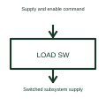

# Integrated load switch

An integrated load switch connects or disconnects a supply path under an enable or control signal.

[Canonical reference](https://eloragrid.ai/symbols/integrated-load-switch) · [Structured record](../entries/integrated-load-switch.json) · [All references](README.md)

Updated: 2026-10-27. Drawing use: Schematic. Reference families: Manufacturer.

## What it represents

An integrated load switch connects or disconnects a supply path under an enable or control signal.
A controller can turn a subsystem's supply on only when it is needed.
Put supply input, switched output and enable control on separate labelled connections. The load switch turns a subsystem’s supply on or off. Soft-start, discharge and fault protection are optional product features; show them only when the chosen device provides them. This is original functional artwork, not a certified standard graphic or device pinout.

## How to read it

- Identify input supply and switched load output.
- Show enable control and any implemented status output.
- Reference startup, discharge and protection features individually.
- Startup control and fault-protection features vary by device; they must not be assumed from the block name.

## Drawing checklist

- Identify input supply and switched load output.
- Show enable control and any implemented status output.
- Reference startup, discharge and protection features individually.

## Important distinction

Startup control and fault-protection features vary by device; they must not be assumed from the block name.

## Facts

- Representation type: Original functional block; not a certified IEC or IEEE graphic
- Concept input: Supply and enable command
- Concept output: Switched subsystem supply

## Public references

- [Load switch functions](https://www.ti.com/product-category/power-management/load-switches/overview.html) — Texas Instruments. Load switch functions: public technical context for the named function. Product and compliance details remain with the publisher.

## Related references

- [Electronic fuse IC](electronic-fuse-ic.md)
- [Power converter / inverter](power-converter.md)
- [Terminal connection](terminal.md)

Original educational concept geometry, CC BY 4.0. Unitless; not a certified standards glyph or manufacturer footprint.

Elora-authored explanations are CC BY 4.0. Linked standards and manufacturer material retain their own rights. Confirm project requirements using primary sources.
