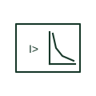

# Inverse-time characteristic qualifier

Qualifier showing that a measuring relay's operating time falls as the measured quantity rises above its setting.

[Canonical reference](https://eloragrid.ai/symbols/inverse-time-characteristic-qualifier) · [Structured record](../entries/inverse-time-characteristic-qualifier.json) · [All references](README.md)

Updated: 2026-10-28. Drawing use: Schematic, SLD. Reference families: IEC.

## What it represents

The inverse-time qualifier marks a measuring element whose operating time depends on how far the measured quantity exceeds the setting: the larger the overcurrent, the faster the trip. On drawings it appears with overcurrent and earth-fault elements that are graded against fuses and downstream relays.
The qualifier does not name the curve. Standard inverse, very inverse and extremely inverse curves grade very differently, and the curve type, time multiplier and pick-up current must be taken from the protection settings.

## How to read it

- Identify the curve type from the settings record.
- Read with the grading study for the feeder.

## Drawing checklist

- State curve type
- State time multiplier
- Reference grading study

## Important distinction

An inverse-time qualifier marks a current-dependent delay; a definite-time qualifier marks a fixed delay.

## Facts

- Meaning: Operating time falls as the quantity rises
- Typical use: Overcurrent and earth-fault grading
- Preview: Independent educational concept; consult the applicable standard and project legend for the exact graphic

## Public references

- [IEC graphical symbols for diagrams](https://tc3.iec.ch/tc-activity/graphical-symbols-for-diagrams/) — IEC. IEC context for graphical symbols used in diagrams; no IEC graphic is reproduced.
- [Fundamental characteristics of a circuit-breaker](https://www.electrical-installation.org/enwiki/Fundamental_characteristics_of_a_circuit-breaker) — Schneider Electric — Electrical Installation Guide. Public explanation of time-current characteristics used in protective devices.

## Related references

- [Definite-time delay qualifier for measuring relays](definite-time-delay-measuring-qualifier.md)
- [Time overcurrent](51-time-overcurrent.md)
- [Maximum-current monitoring relay](maximum-current-monitoring-relay.md)

Original educational concept geometry, CC BY 4.0. Unitless; not a certified standards glyph or manufacturer footprint.

Elora-authored explanations are CC BY 4.0. Linked standards and manufacturer material retain their own rights. Confirm project requirements using primary sources.
