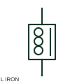

# Iron-core reactor

An iron-core reactor uses a documented magnetic core to provide its inductive characteristic.

[Canonical reference](https://eloragrid.ai/symbols/iron-core-reactor) · [Structured record](../entries/iron-core-reactor.json) · [All references](README.md)

Updated: 2026-10-27. Drawing use: SLD, Schematic. Reference families: IEC, Manufacturer.

## What it represents

An iron-core reactor uses a documented magnetic core to provide its inductive characteristic. Its core and saturation behaviour belong to the selected equipment data.

## How to read it

- Do not infer linear behaviour at every current level from an iron-core marker.
- The preview is an original explanation of this function. Match the actual drawing convention to its legend and the selected equipment documentation.

## Drawing checklist

- Identify circuit connection
- State rated current/inductance
- Reference core operating limits

## Important distinction

Iron-core construction is different from an air-core reactor.

## Facts

- Drawing role: Inductive component
- Representation scope: Functional concept; not an official standard graphic or a product footprint
- Public vendor block reference: HRT1IC, VRT1IC (Autodesk identifiers; not IEC symbol numbers)
- Identifier status: The short label is a functional lookup label, not an assigned IEC or IEEE symbol number. Any separately listed Autodesk code is a verified vendor block name.

## Public references

- [AutoCAD Electrical: Reactors and inductors](https://help.autodesk.com/cloudhelp/2021/ENU/AutoCAD-Electrical/files/GUID-BAD50DBF-0951-44A0-BB4C-A57B4A4ED895.htm) — Autodesk. Public documentation of this equipment function or named vendor variant; the illustration is independently authored and is not the source graphic.

## Related references

- [Power transformer](power-transformer.md)
- [Capacitor](capacitor.md)

Original educational concept geometry, CC BY 4.0. Unitless; not a certified standards glyph or manufacturer footprint.

Elora-authored explanations are CC BY 4.0. Linked standards and manufacturer material retain their own rights. Confirm project requirements using primary sources.
