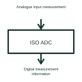

# Isolated analogue-to-digital converter

An isolated ADC converts an analogue measurement into digital information across its specified isolation arrangement.

[Canonical reference](https://eloragrid.ai/symbols/isolated-analogue-to-digital-converter) · [Structured record](../entries/isolated-analogue-to-digital-converter.json) · [All references](README.md)

Updated: 2026-10-27. Drawing use: Schematic. Reference families: Manufacturer.

## What it represents

An isolated ADC converts an analogue measurement into digital information across its specified isolation arrangement.
A converter can provide current or voltage measurement data from one circuit domain to another.
Identify the analogue measurement domain, isolation boundary and digital output format. Some measurement converters need external filtering or processing to obtain the final reported value. Keep that processing visible so a raw digital stream is not mistaken for an immediately usable engineering-unit reading. This is original functional artwork, not a certified standard graphic or device pinout.

## How to read it

- Name the analogue input quantity and scaling.
- Identify the isolation domains and required supplies.
- Reference the digital format and any downstream filtering.
- Conversion, isolation and any required digital filtering are separate parts of the measurement chain.

## Drawing checklist

- Name the analogue input quantity and scaling.
- Identify the isolation domains and required supplies.
- Reference the digital format and any downstream filtering.

## Important distinction

Conversion, isolation and any required digital filtering are separate parts of the measurement chain.

## Facts

- Representation type: Original functional block; not a certified IEC or IEEE graphic
- Concept input: Analogue input measurement
- Concept output: Digital measurement information

## Public references

- [Isolated measurement conversion](https://www.ti.com/product-category/isolation/isolated-adcs/overview.html) — Texas Instruments. Isolated measurement conversion: public technical context for the named function. Product and compliance details remain with the publisher.

## Related references

- [Analogue-to-digital converter](analog-to-digital-converter.md)
- [Power converter / inverter](power-converter.md)
- [Terminal connection](terminal.md)

Original educational concept geometry, CC BY 4.0. Unitless; not a certified standards glyph or manufacturer footprint.

Elora-authored explanations are CC BY 4.0. Linked standards and manufacturer material retain their own rights. Confirm project requirements using primary sources.
