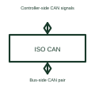

# Isolated CAN transceiver

An isolated CAN interface combines a CAN signal path with its specified electrical isolation barrier.

[Canonical reference](https://eloragrid.ai/symbols/isolated-can-transceiver) · [Structured record](../entries/isolated-can-transceiver.json) · [All references](README.md)

Updated: 2026-10-27. Drawing use: Schematic. Reference families: Manufacturer.

## What it represents

An isolated CAN interface combines a CAN signal path with its specified electrical isolation barrier.
A controller-side circuit can communicate with a bus-side circuit referenced to another electrical domain.
Show the controller domain, isolation boundary and bus domain explicitly. The CAN electrical interface is on the bus side, while logic signals cross the selected barrier. A complete diagram also accounts for bus-side power, termination and protection rather than treating isolation as the whole network design. This is original functional artwork, not a certified standard graphic or device pinout.

## How to read it

- Identify supply and reference for both domains.
- Show CAN controller signals and bus connections separately.
- Reference isolation, termination and bus-protection requirements.
- The isolation barrier and any power supply for the bus side must be accounted for separately.

## Drawing checklist

- Identify supply and reference for both domains.
- Show CAN controller signals and bus connections separately.
- Reference isolation, termination and bus-protection requirements.

## Important distinction

The isolation barrier and any power supply for the bus side must be accounted for separately.

## Facts

- Representation type: Original functional block; not a certified IEC or IEEE graphic
- Concept input: Controller-side CAN signals
- Concept output: Bus-side CAN pair

## Public references

- [Isolated communication interfaces](https://www.ti.com/product-category/isolation/isolated-interface-ics/overview.html) — Texas Instruments. Isolated communication interfaces: public technical context for the named function. Product and compliance details remain with the publisher.

## Related references

- [Capacitive digital isolator](capacitive-digital-isolator.md)
- [Isolated RS-485 transceiver](isolated-rs-485-transceiver.md)
- [Isolated I2C interface](isolated-i2c-interface.md)
- [Power converter / inverter](power-converter.md)

Original educational concept geometry, CC BY 4.0. Unitless; not a certified standards glyph or manufacturer footprint.

Elora-authored explanations are CC BY 4.0. Linked standards and manufacturer material retain their own rights. Confirm project requirements using primary sources.
