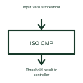

# Isolated comparator

An isolated comparator evaluates an input condition and transfers its comparison result across an isolation barrier.

[Canonical reference](https://eloragrid.ai/symbols/isolated-comparator) · [Structured record](../entries/isolated-comparator.json) · [All references](README.md)

Updated: 2026-10-27. Drawing use: Schematic. Reference families: Manufacturer.

## What it represents

An isolated comparator evaluates an input condition and transfers its comparison result across an isolation barrier.
A higher-voltage measurement domain can provide a threshold result to a separate controller domain.
Show the measured condition and comparison reference on the appropriate side of the isolation barrier, then label the result sent to the controller. A comparator reports a threshold relationship. It should not be drawn as if it continuously reports the full measured analogue value. This is original functional artwork, not a certified standard graphic or device pinout.

## How to read it

- Identify the monitored input and comparison condition.
- Show the isolation boundary and both reference domains.
- Label the output as a threshold result.
- A threshold indication is different from a continuously measured analogue value.

## Drawing checklist

- Identify the monitored input and comparison condition.
- Show the isolation boundary and both reference domains.
- Label the output as a threshold result.

## Important distinction

A threshold indication is different from a continuously measured analogue value.

## Facts

- Representation type: Original functional block; not a certified IEC or IEEE graphic
- Concept input: Input versus threshold
- Concept output: Threshold result to controller

## Public references

- [Isolated signal and control functions](https://www.ti.com/product-category/isolation/overview.html) — Texas Instruments. Isolated signal and control functions: public technical context for the named function. Product and compliance details remain with the publisher.

## Related references

- [Capacitive digital isolator](capacitive-digital-isolator.md)
- [Magnetic digital isolator](magnetic-digital-isolator.md)
- [Power converter / inverter](power-converter.md)
- [Terminal connection](terminal.md)

Original educational concept geometry, CC BY 4.0. Unitless; not a certified standards glyph or manufacturer footprint.

Elora-authored explanations are CC BY 4.0. Linked standards and manufacturer material retain their own rights. Confirm project requirements using primary sources.
