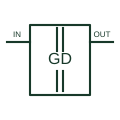

# Isolated gate driver

Transfers a switching command across an isolation barrier and drives a power-transistor gate circuit.

[Canonical reference](https://eloragrid.ai/symbols/isolated-gate-driver) · [Structured record](../entries/isolated-gate-driver.json) · [All references](README.md)

Updated: 2026-10-27. Drawing use: Schematic. Reference families: Manufacturer.

## What it represents

Transfers a switching command across an isolation barrier and drives a power-transistor gate circuit.
On a schematic, identify input/output domain supplies, driver return and fault/desaturation pins and trace the gate connection, interlock and converter protection interfaces. Keep the component tag and signal/reference names consistent across the control drawing, terminal schedule and device documentation.
A gate driver adds drive capability and device-specific supervision; it is not merely a general-purpose digital isolator.
The preview is an independently drawn educational functional reference. Add the selected component’s actual power pins, terminal numbers, timing or analogue reference details when producing a construction drawing.

## How to read it

- Identify input/output domain supplies, driver return and fault/desaturation pins.
- Trace the gate connection, interlock and converter protection interfaces.

## Drawing checklist

- Label input/output domain supplies, driver return and fault/desaturation pins.
- Cross-reference the gate connection, interlock and converter protection interfaces.
- Add the selected device or circuit documentation revision, power/reference connections and project signal convention.

## Important distinction

A gate driver adds drive capability and device-specific supervision; it is not merely a general-purpose digital isolator.

## Facts

- Common schematic mnemonic: ISO-GD — descriptive only; project/device documentation defines reference designations.
- Terminal / interface focus: Input/output domain supplies, driver return and fault/desaturation pins
- Artwork scope: Original educational functional/circuit reference; not a selected product pinout.

## Public references

- [UCC21750 — isolated gate-driver interfaces](https://www.ti.com/product/UCC21750) — Texas Instruments. Public primary manufacturer documentation establishes the component function or circuit/topology relationship. Preview geometry and drafting explanations are independently authored.

## Related references

- [Insulated-gate bipolar transistor](insulated-gate-bipolar-transistor.md)
- [Diode](diode.md)

Original educational concept geometry, CC BY 4.0. Unitless; not a certified standards glyph or manufacturer footprint.

Elora-authored explanations are CC BY 4.0. Linked standards and manufacturer material retain their own rights. Confirm project requirements using primary sources.
