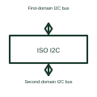

# Isolated I2C interface

An isolated I2C interface transfers the required bus behaviour across an electrical isolation barrier.

[Canonical reference](https://eloragrid.ai/symbols/isolated-i2c-interface) · [Structured record](../entries/isolated-i2c-interface.json) · [All references](README.md)

Updated: 2026-10-27. Drawing use: Schematic. Reference families: Manufacturer.

## What it represents

An isolated I2C interface transfers the required bus behaviour across an electrical isolation barrier.
Two circuit domains can communicate using a suitable isolator designed for their I2C arrangement.
Show clock and data transfer across the barrier while identifying each side’s pull-ups and power. I2C includes bidirectional bus behaviour, so a generic isolator cannot be substituted without checking that behaviour. Use the selected I2C isolator’s supported arrangement and timing requirements. This is original functional artwork, not a certified standard graphic or device pinout.

## How to read it

- Identify clock and data on both isolated domains.
- Show each side’s supply and pull-up arrangement.
- Reference bidirectional behaviour and supported bus timing.
- An ordinary digital isolator is not automatically suitable for every bidirectional I2C signal path.

## Drawing checklist

- Identify clock and data on both isolated domains.
- Show each side’s supply and pull-up arrangement.
- Reference bidirectional behaviour and supported bus timing.

## Important distinction

An ordinary digital isolator is not automatically suitable for every bidirectional I2C signal path.

## Facts

- Representation type: Original functional block; not a certified IEC or IEEE graphic
- Concept input: First-domain I2C bus
- Concept output: Second-domain I2C bus

## Public references

- [Isolated communication interfaces](https://www.ti.com/product-category/isolation/isolated-interface-ics/overview.html) — Texas Instruments. Isolated communication interfaces: public technical context for the named function. Product and compliance details remain with the publisher.

## Related references

- [Capacitive digital isolator](capacitive-digital-isolator.md)
- [Isolated CAN transceiver](isolated-can-transceiver.md)
- [Isolated RS-485 transceiver](isolated-rs-485-transceiver.md)
- [Power converter / inverter](power-converter.md)

Original educational concept geometry, CC BY 4.0. Unitless; not a certified standards glyph or manufacturer footprint.

Elora-authored explanations are CC BY 4.0. Linked standards and manufacturer material retain their own rights. Confirm project requirements using primary sources.
