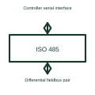

# Isolated RS-485 transceiver

An isolated RS-485 interface transfers compatible serial communication across a specified isolation barrier.

[Canonical reference](https://eloragrid.ai/symbols/isolated-rs-485-transceiver) · [Structured record](../entries/isolated-rs-485-transceiver.json) · [All references](README.md)

Updated: 2026-10-27. Drawing use: Schematic. Reference families: Manufacturer.

## What it represents

An isolated RS-485 interface transfers compatible serial communication across a specified isolation barrier.
A fieldbus interface can separate controller and bus electrical references using the selected isolated device.
Draw the serial logic connection, isolation barrier and differential bus pair as separate roles. Label bus-side power and any direction-enable signals. Isolation changes the relationship between circuit references; it does not remove the need to define cable topology, termination and the application protocol. This is original functional artwork, not a certified standard graphic or device pinout.

## How to read it

- Show controller and bus reference domains.
- Reference bus-side power and direction control.
- Identify termination, protection and the application protocol.
- Isolation does not remove the need to design the cable, termination and bus protection.

## Drawing checklist

- Show controller and bus reference domains.
- Reference bus-side power and direction control.
- Identify termination, protection and the application protocol.

## Important distinction

Isolation does not remove the need to design the cable, termination and bus protection.

## Facts

- Representation type: Original functional block; not a certified IEC or IEEE graphic
- Concept input: Controller serial interface
- Concept output: Differential fieldbus pair

## Public references

- [Isolated communication interfaces](https://www.ti.com/product-category/isolation/isolated-interface-ics/overview.html) — Texas Instruments. Isolated communication interfaces: public technical context for the named function. Product and compliance details remain with the publisher.

## Related references

- [Capacitive digital isolator](capacitive-digital-isolator.md)
- [Isolated CAN transceiver](isolated-can-transceiver.md)
- [Isolated I2C interface](isolated-i2c-interface.md)
- [Power converter / inverter](power-converter.md)

Original educational concept geometry, CC BY 4.0. Unitless; not a certified standards glyph or manufacturer footprint.

Elora-authored explanations are CC BY 4.0. Linked standards and manufacturer material retain their own rights. Confirm project requirements using primary sources.
