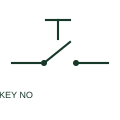

# Key-operated normally-open switch

A key-operated NO switch closes a contact through an authorised key mechanism.

[Canonical reference](https://eloragrid.ai/symbols/key-operated-normally-open-switch) · [Structured record](../entries/key-operated-normally-open-switch.json) · [All references](README.md)

Updated: 2026-10-27. Drawing use: Schematic. Reference families: IEC, Manufacturer.

## What it represents

A key-operated NO switch closes a contact through an authorised key mechanism. The schematic needs the operating positions and any key-removal restrictions to explain access control.

## How to read it

- Check where the key can be inserted or removed.
- The preview is an original explanation of this function. Match the actual drawing convention to its legend and the selected equipment documentation.

## Drawing checklist

- Label positions
- Identify key-removal state
- Show contact terminals

## Important distinction

A key switch restricts operation but is not automatically an electrical isolation or safety device.

## Facts

- Drawing role: Manual operation
- Representation scope: Functional concept; not an official standard graphic or a product footprint
- Public vendor block reference: HPB11KS, VPB11KS (Autodesk identifiers; not IEC symbol numbers)
- Identifier status: The short label is a functional lookup label, not an assigned IEC or IEEE symbol number. Any separately listed Autodesk code is a verified vendor block name.

## Public references

- [AutoCAD Electrical: Level, flow, keyed and measurement switches](https://help.autodesk.com/cloudhelp/2021/ENU/AutoCAD-Electrical/files/GUID-1FB94435-C954-4479-BD97-25796DB8F728.htm) — Autodesk. Public documentation of this equipment function or named vendor variant; the illustration is independently authored and is not the source graphic.

## Related references

- [Normally open pushbutton](pushbutton-no.md)
- [Normally closed pushbutton](pushbutton-nc.md)

Original educational concept geometry, CC BY 4.0. Unitless; not a certified standards glyph or manufacturer footprint.

Elora-authored explanations are CC BY 4.0. Linked standards and manufacturer material retain their own rights. Confirm project requirements using primary sources.
