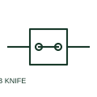

# Knife-disconnect terminal

A knife-disconnect terminal opens its circuit path using a documented pivoting knife element.

[Canonical reference](https://eloragrid.ai/symbols/knife-disconnect-terminal) · [Structured record](../entries/knife-disconnect-terminal.json) · [All references](README.md)

Updated: 2026-10-27. Drawing use: Schematic. Reference families: Manufacturer.

## What it represents

A knife-disconnect terminal opens its circuit path using a documented pivoting knife element. The schematic records the separable connection and the terminal plan identifies the selected physical terminal.

## How to read it

- Follow the knife element rather than assuming every terminal level opens together.
- The preview is an original explanation of this function. Match the actual drawing convention to its legend and the selected equipment documentation.

## Drawing checklist

- Show opened path
- State normal knife position
- Reference terminal model

## Important distinction

A visible knife disconnect differs mechanically from an isolating plug terminal.

## Facts

- Drawing role: Wiring interface
- Representation scope: Functional concept; not an official standard graphic or a product footprint
- Identifier status: The short label is a functional lookup label, not an assigned IEC or IEEE symbol number. Any separately listed Autodesk code is a verified vendor block name.

## Public references

- [Terminal block functional families](https://www.phoenixcontact.com/en-gb/products/terminal-blocks) — Phoenix Contact. Public documentation of this equipment function or named vendor variant; the illustration is independently authored and is not the source graphic.

## Related references

- [Terminal connection](terminal.md)
- [Terminal strip assembly](terminal-strip.md)

Original educational concept geometry, CC BY 4.0. Unitless; not a certified standards glyph or manufacturer footprint.

Elora-authored explanations are CC BY 4.0. Linked standards and manufacturer material retain their own rights. Confirm project requirements using primary sources.
