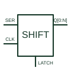

# Shift register with output latch

Combines a serial shift path with a separate output-storage stage.

[Canonical reference](https://eloragrid.ai/symbols/latched-shift-register) · [Structured record](../entries/latched-shift-register.json) · [All references](README.md)

Updated: 2026-10-27. Drawing use: Schematic. Reference families: Manufacturer.

## What it represents

Combines a serial shift path with a separate output-storage stage.
On a schematic, identify the shift clock, output-latch clock and output-enable polarity and trace the output word and serial-cascade connection. Keep the component tag and signal/reference names consistent across the control drawing, terminal schedule and device documentation.
The shift clock changes internal shift storage; a separate latch action updates the retained output word.
The preview is an independently drawn educational functional reference. Add the selected component’s actual power pins, terminal numbers, timing or analogue reference details when producing a construction drawing.

## How to read it

- Identify the shift clock, output-latch clock and output-enable polarity.
- Trace the output word and serial-cascade connection.

## Drawing checklist

- Label the shift clock, output-latch clock and output-enable polarity.
- Cross-reference the output word and serial-cascade connection.
- Add the selected device or circuit documentation revision, power/reference connections and project signal convention.

## Important distinction

The shift clock changes internal shift storage; a separate latch action updates the retained output word.

## Facts

- Common schematic mnemonic: SHIFT-LATCH — descriptive only; project/device documentation defines reference designations.
- Terminal / interface focus: The shift clock, output-latch clock and output-enable polarity
- Artwork scope: Original educational functional/circuit reference; not a selected product pinout.

## Public references

- [SN74HC595 — shift registers with separate output storage](https://www.ti.com/lit/ds/symlink/sn74hc595.pdf) — Texas Instruments. Public primary manufacturer documentation establishes the component function or circuit/topology relationship. Preview geometry and drafting explanations are independently authored.

## Related references

- [Serial-in parallel-out register](serial-in-parallel-out-register.md)
- [PLC input / output](plc-io.md)

Original educational concept geometry, CC BY 4.0. Unitless; not a certified standards glyph or manufacturer footprint.

Elora-authored explanations are CC BY 4.0. Linked standards and manufacturer material retain their own rights. Confirm project requirements using primary sources.
