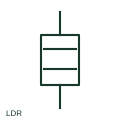

# Light-dependent resistor

A light-dependent resistor changes resistance according to illumination.

[Canonical reference](https://eloragrid.ai/symbols/light-dependent-resistor) · [Structured record](../entries/light-dependent-resistor.json) · [All references](README.md)

Updated: 2026-10-27. Drawing use: SLD, Schematic. Reference families: IEC, Manufacturer.

## What it represents

A light-dependent resistor changes resistance according to illumination. The schematic places the sensing element in its actual electrical network and the equipment detail identifies the illumination conditions.

## How to read it

- A surrounding light-sensitive marker describes the component response, not a supply terminal.
- The preview is an original explanation of this function. Match the actual drawing convention to its legend and the selected equipment documentation.

## Drawing checklist

- State component characteristic
- Identify measured circuit
- Reference illumination arrangement

## Important distinction

An LDR changes resistance; a photodiode produces a different semiconductor sensing response.

## Facts

- Drawing role: Passive circuit element
- Representation scope: Functional concept; not an official standard graphic or a product footprint
- Public vendor block reference: HRE1LDR, VRE1LDR (Autodesk identifiers; not IEC symbol numbers)
- Identifier status: The short label is a functional lookup label, not an assigned IEC or IEEE symbol number. Any separately listed Autodesk code is a verified vendor block name.

## Public references

- [Resistors and heater-element symbols](https://help.autodesk.com/cloudhelp/2021/ENU/AutoCAD-Electrical/files/GUID-1D071951-D38E-4B15-8B9E-C30ECBD55C19.htm) — Autodesk. Public documentation of this equipment function or named vendor variant; the illustration is independently authored and is not the source graphic.

## Related references

- [Resistor](resistor.md)
- [Capacitor](capacitor.md)

Original educational concept geometry, CC BY 4.0. Unitless; not a certified standards glyph or manufacturer footprint.

Elora-authored explanations are CC BY 4.0. Linked standards and manufacturer material retain their own rights. Confirm project requirements using primary sources.
