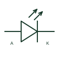

# Light-emitting diode

A semiconductor diode that emits light when operated with the appropriate forward current.

[Canonical reference](https://eloragrid.ai/symbols/light-emitting-diode) · [Structured record](../entries/light-emitting-diode.json) · [All references](README.md)

Updated: 2026-10-27. Drawing use: Schematic. Reference families: Manufacturer.

## What it represents

A semiconductor diode that emits light when operated with the appropriate forward current.
On a schematic, identify anode/cathode polarity and the current-limiting circuit and trace the optical indication or emitter function. Keep the component tag and signal/reference names consistent across the control drawing, terminal schedule and device documentation.
A bare LED needs its external operating circuit; the existing LED indicator-lamp record describes an assembled indicating device.
Terminal letters describe electrical roles, not package pin numbers. Check the selected public datasheet for the actual pin assignment, polarity and any internally connected terminals before completing the drawing.

## How to read it

- Identify anode/cathode polarity and the current-limiting circuit.
- Trace the optical indication or emitter function.

## Drawing checklist

- Label anode/cathode polarity and the current-limiting circuit.
- Cross-reference the optical indication or emitter function.
- Add the selected device or circuit documentation revision, power/reference connections and project signal convention.

## Important distinction

A bare LED needs its external operating circuit; the existing LED indicator-lamp record describes an assembled indicating device.

## Facts

- Common schematic mnemonic: LED — descriptive only; project/device documentation defines reference designations.
- Terminal / interface focus: Anode/cathode polarity and the current-limiting circuit
- Artwork scope: Original educational component glyph; not a certified standard graphic or package pinout.

## Public references

- [Visible LED component families](https://www.vishay.com/en/leds/) — Vishay. Public primary manufacturer documentation establishes the component function or circuit/topology relationship. Preview geometry and drafting explanations are independently authored.

## Related references

- [LED indicator lamp](led-indicator-lamp.md)
- [Diode](diode.md)

Original educational concept geometry, CC BY 4.0. Unitless; not a certified standards glyph or manufacturer footprint.

Elora-authored explanations are CC BY 4.0. Linked standards and manufacturer material retain their own rights. Confirm project requirements using primary sources.
