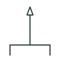

# Lightning air termination

A rod or mesh conductor on top of a structure intended to intercept lightning strikes before they hit the structure.

[Canonical reference](https://eloragrid.ai/symbols/lightning-air-termination) · [Structured record](../entries/lightning-air-termination.json) · [All references](README.md)

Updated: 2026-10-28. Drawing use: GA, Schematic. Reference families: IEC, IEEE / ANSI.

## What it represents

The air termination is the capture device of a lightning protection system. It can be a vertical rod, a stretched wire or a roof mesh. Roof plans mark rods at their positions, and the protected zone around them is set by the design method used.
The symbol does not show height, protective angle or the design method. Rooftop equipment such as solar arrays and air conditioning plant within the protected zone may still need bonding or separation, which should appear on the lightning protection layout.

## How to read it

- Check rooftop equipment against the protected zone.
- Read rod heights from the layout notes.

## Drawing checklist

- Show every air termination position.
- State rod height or mesh size.
- Link to the down-conductor routes.

## Important distinction

An air termination captures the strike; a surge arrester limits overvoltage on electrical conductors.

## Facts

- Graphic cue: Upward-pointing rod on a structure outline
- System role: Capture device of the lightning protection system
- Preview: Original educational illustration; consult the publisher and applicable standard for the exact graphic

## Public references

- [Building protection system](https://www.electrical-installation.org/enwiki/Building_protection_system) — Schneider Electric, Electrical Installation Guide. Public installation-guide description of lightning rods and capture devices.
- [IEC-60617 symbol preview directory](https://help.autodesk.com/cloudhelp/2021/ENU/AutoCAD-Electrical/files/GUID-7871E6EF-24D5-467E-9B74-321FEDC9DFDA.htm) — Autodesk. Public directory of IEC-oriented symbol families.

## Related references

- [Lightning protection down-conductor](lightning-down-conductor.md)
- [Lightning protection test joint](lightning-test-joint.md)
- [Surge arrester](surge-arrester.md)

Original educational concept geometry, CC BY 4.0. Unitless; not a certified standards glyph or manufacturer footprint.

Elora-authored explanations are CC BY 4.0. Linked standards and manufacturer material retain their own rights. Confirm project requirements using primary sources.
