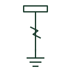

# Lightning protection down-conductor

The conductor carrying lightning current from air terminations on a structure down to the earth termination system.

[Canonical reference](https://eloragrid.ai/symbols/lightning-down-conductor) · [Structured record](../entries/lightning-down-conductor.json) · [All references](README.md)

Updated: 2026-10-28. Drawing use: GA, Schematic. Reference families: IEC, IEEE / ANSI.

## What it represents

Down-conductors run from the air termination network on the roof to the earth electrodes, carrying lightning current by the shortest practical path. Installation guidance describes them as part of the building protection system together with the capture device and earth leads. Elevations and roof plans show them as a distinct line style.
The symbol does not tell you material, cross-section or separation distance from internal services. Insufficient separation can cause side flashes into wiring. Structural steel or reinforcing used as natural down-conductors may not be drawn explicitly, so check the lightning protection design notes.

## How to read it

- Check separation from internal wiring and services.
- Identify whether structural steel is used as a down path.

## Drawing checklist

- Show each down-conductor route.
- State material and size.
- Show test joint and earth termination at the base.

## Important distinction

A down-conductor carries lightning current to earth; a protective earth conductor carries fault current from the electrical installation.

## Facts

- Graphic cue: Vertical line with arrow or lightning mark from roof to earth
- System role: Path from air termination to earth
- Preview: Original educational illustration; consult the publisher and applicable standard for the exact graphic

## Public references

- [Building protection system](https://www.electrical-installation.org/enwiki/Building_protection_system) — Schneider Electric, Electrical Installation Guide. Public installation-guide description of building lightning protection with down-conductors.
- [AutoCAD Electrical: Earthing, sources and surge protection](https://help.autodesk.com/cloudhelp/2021/ENU/AutoCAD-Electrical/files/GUID-1E3FDEAE-B4B2-417C-8075-108AA2C6E509.htm) — Autodesk. Public IEC-oriented earth forms.

## Related references

- [Lightning air termination](lightning-air-termination.md)
- [Lightning protection test joint](lightning-test-joint.md)
- [Surge arrester](surge-arrester.md)

Original educational concept geometry, CC BY 4.0. Unitless; not a certified standards glyph or manufacturer footprint.

Elora-authored explanations are CC BY 4.0. Linked standards and manufacturer material retain their own rights. Confirm project requirements using primary sources.
