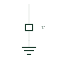

# Lightning protection test joint

A disconnectable joint near the base of a down-conductor that allows the earth termination to be tested separately.

[Canonical reference](https://eloragrid.ai/symbols/lightning-test-joint) · [Structured record](../entries/lightning-test-joint.json) · [All references](README.md)

Updated: 2026-10-28. Drawing use: GA, Schematic. Reference families: IEC, IEEE / ANSI.

## What it represents

Each down-conductor usually has a test joint at a convenient height above ground. Opening it separates the above-ground lightning conductor from the earth electrode, so electrode resistance and conductor continuity can be measured. Elevations show it as a small box or clamp mark on the down-conductor.
The test joint is not an isolating device for electrical work; it is only opened for inspection with no storm risk. The symbol does not specify clamp type or whether it is housed in a box. Missing or painted-over test joints are a common inspection finding.

## How to read it

- Locate the test joint on each down-conductor.
- Confirm it is reachable for inspection.

## Drawing checklist

- Show a test joint on every down-conductor.
- State mounting height.
- Number joints to match inspection records.

## Important distinction

A lightning test joint separates the down-conductor from its electrode; an earth test link separates the installation MET from its electrode.

## Facts

- Graphic cue: Small box or clamp mark near the base of a down-conductor
- Use: Electrode and continuity testing
- Preview: Original educational illustration; consult the publisher and applicable standard for the exact graphic

## Public references

- [Building protection system](https://www.electrical-installation.org/enwiki/Building_protection_system) — Schneider Electric, Electrical Installation Guide. Public installation-guide description of lightning protection earth leads and down-conductors.
- [Earthing connections](https://www.electrical-installation.org/enwiki/Earthing_connections) — Schneider Electric, Electrical Installation Guide. Public installation-guide earthing elements.

## Related references

- [Lightning protection down-conductor](lightning-down-conductor.md)
- [Removable earth test link](iec-removable-earth-test-link.md)
- [Earth electrode](iec-earth-electrode.md)

Original educational concept geometry, CC BY 4.0. Unitless; not a certified standards glyph or manufacturer footprint.

Elora-authored explanations are CC BY 4.0. Linked standards and manufacturer material retain their own rights. Confirm project requirements using primary sources.
