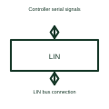

# LIN bus transceiver

LIN means Local Interconnect Network, a communication system for connected electronic devices. Its transceiver handles the network's electrical signals.

[Canonical reference](https://eloragrid.ai/symbols/lin-bus-transceiver) · [Structured record](../entries/lin-bus-transceiver.json) · [All references](README.md)

Updated: 2026-10-27. Drawing use: Schematic. Reference families: Manufacturer.

## What it represents

LIN means Local Interconnect Network, a communication system for connected electronic devices. Its transceiver handles the network's electrical signals.
A small control network can connect an electronic controller to its LIN bus through this interface.
Draw the controller’s logic interface separately from the LIN bus connection. The transceiver adapts electrical signalling; the complete LIN network also needs its selected control and communication arrangement. Identify supply, reference and any sleep or wake interfaces provided by the chosen device. This is original functional artwork, not a certified standard graphic or device pinout.

## How to read it

- Identify the controller and bus sides.
- Reference the selected network and supply arrangement.
- Show enable, sleep or wake connections where the device uses them.
- LIN and CAN are different interfaces and must not be treated as interchangeable wiring.

## Drawing checklist

- Identify the controller and bus sides.
- Reference the selected network and supply arrangement.
- Show enable, sleep or wake connections where the device uses them.

## Important distinction

LIN and CAN are different interfaces and must not be treated as interchangeable wiring.

## Facts

- Representation type: Original functional block; not a certified IEC or IEEE graphic
- Concept input: Controller serial signals
- Concept output: LIN bus connection

## Public references

- [LIN transceiver functions](https://www.ti.com/product-category/interface/lin-transceivers/overview.html) — Texas Instruments. LIN transceiver functions: public technical context for the named function. Product and compliance details remain with the publisher.

## Related references

- [Logic bus transceiver](logic-bus-transceiver.md)
- [Power converter / inverter](power-converter.md)
- [Terminal connection](terminal.md)

Original educational concept geometry, CC BY 4.0. Unitless; not a certified standards glyph or manufacturer footprint.

Elora-authored explanations are CC BY 4.0. Linked standards and manufacturer material retain their own rights. Confirm project requirements using primary sources.
