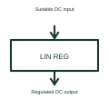

# Linear voltage regulator

A linear regulator controls its pass element to maintain a specified output voltage from a suitable input.

[Canonical reference](https://eloragrid.ai/symbols/linear-voltage-regulator) · [Structured record](../entries/linear-voltage-regulator.json) · [All references](README.md)

Updated: 2026-10-27. Drawing use: Schematic. Reference families: Manufacturer.

## What it represents

A linear regulator controls its pass element to maintain a specified output voltage from a suitable input.
A small electronic circuit can receive a regulated supply from a higher DC input through the selected regulator.
Show input supply, regulated output and the regulator’s reference connection. A linear regulator adjusts its conducting element rather than using the same switching arrangement as a switch-mode converter. The input/output difference and load affect heat, which must be assessed for the actual device and installation. This is original functional artwork, not a certified standard graphic or device pinout.

## How to read it

- Identify input, output and reference connections.
- Reference required headroom and output components.
- Check the selected load and thermal arrangement.
- The input/output voltage difference and load create heat that must be considered.

## Drawing checklist

- Identify input, output and reference connections.
- Reference required headroom and output components.
- Check the selected load and thermal arrangement.

## Important distinction

The input/output voltage difference and load create heat that must be considered.

## Facts

- Representation type: Original functional block; not a certified IEC or IEEE graphic
- Concept input: Suitable DC input
- Concept output: Regulated DC output

## Public references

- [Linear voltage regulation](https://www.ti.com/product-category/power-management/linear-ldo-regulators/overview.html) — Texas Instruments. Linear voltage regulation: public technical context for the named function. Product and compliance details remain with the publisher.

## Related references

- [Series voltage reference](series-voltage-reference.md)
- [Low-dropout voltage regulator](low-dropout-voltage-regulator.md)
- [Power converter / inverter](power-converter.md)
- [Terminal connection](terminal.md)

Original educational concept geometry, CC BY 4.0. Unitless; not a certified standards glyph or manufacturer footprint.

Elora-authored explanations are CC BY 4.0. Linked standards and manufacturer material retain their own rights. Confirm project requirements using primary sources.
