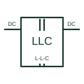

# LLC resonant converter topology

A converter arrangement using the documented resonant inductive/capacitive network and magnetic transfer path.

[Canonical reference](https://eloragrid.ai/symbols/llc-resonant-converter-topology) · [Structured record](../entries/llc-resonant-converter-topology.json) · [All references](README.md)

Updated: 2026-10-27. Drawing use: Schematic, SLD. Reference families: Manufacturer.

## What it represents

A converter arrangement using the documented resonant inductive/capacitive network and magnetic transfer path.
On a schematic, identify the resonant inductor/capacitor, magnetising inductance and switching bridge and trace the secondary output and resonant-controller interface. Keep the component tag and signal/reference names consistent across the control drawing, terminal schedule and device documentation.
The LLC designation identifies a resonant network arrangement; it does not state component values, switching limits or efficiency.
The preview is a conceptual topology reference rather than a complete power-stage circuit. Switching sequences, magnetic design, component selection and control/protection details belong in the equipment design documentation.

## How to read it

- Identify the resonant inductor/capacitor, magnetising inductance and switching bridge.
- Trace the secondary output and resonant-controller interface.

## Drawing checklist

- Label the resonant inductor/capacitor, magnetising inductance and switching bridge.
- Cross-reference the secondary output and resonant-controller interface.
- Add the selected device or circuit documentation revision, power/reference connections and project signal convention.

## Important distinction

The LLC designation identifies a resonant network arrangement; it does not state component values, switching limits or efficiency.

## Facts

- Common schematic mnemonic: LLC — descriptive only; project/device documentation defines reference designations.
- Terminal / interface focus: The resonant inductor/capacitor, magnetising inductance and switching bridge
- Artwork scope: Original conceptual topology block; not a complete switch-level circuit.

## Public references

- [UCC256404 — LLC resonant-converter control](https://www.ti.com/product/UCC256404) — Texas Instruments. Public primary manufacturer documentation establishes the component function or circuit/topology relationship. Preview geometry and drafting explanations are independently authored.

## Related references

- [Half-bridge DC converter topology](half-bridge-dc-converter-topology.md)
- [Power converter / inverter](power-converter.md)

Original educational concept geometry, CC BY 4.0. Unitless; not a certified standards glyph or manufacturer footprint.

Elora-authored explanations are CC BY 4.0. Linked standards and manufacturer material retain their own rights. Confirm project requirements using primary sources.
