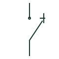

# Load-break switch

A switch with a specified capability to make and break normal load current.

[Canonical reference](https://eloragrid.ai/symbols/load-break-switch) · [Structured record](../entries/load-break-switch.json) · [All references](README.md)

Updated: 2026-10-27. Drawing use: SLD, Schematic. Reference families: IEC, IEEE / ANSI.

## What it represents

A load-break switch operates a loaded circuit under the normal conditions covered by its rating. It should not be confused with a circuit breaker, whose specified duties can include interrupting fault current. Some products combine switching and isolation, and some are used with fuses for a protection arrangement.
The SLD shows where the switch connects the circuit. Its schedule or manufacturer reference establishes the duty and capabilities. The device name, qualifiers and associated protective equipment explain more than the generic mark alone.

## How to read it

- Look for a separately identified fuse or breaker in the protection path.
- Check whether isolation is an additional specified function of the chosen product.

## Drawing checklist

- Reference the load-switching capability.
- Identify any associated protection device.
- Record the product type and operating arrangement.

## Important distinction

Fault-making, load-breaking and fault-breaking are different capabilities. Avoid using a single switch label as a substitute for the equipment specification.

## Facts

- Primary role: Normal-load switching
- Protection: May rely on separate protective devices
- Combined duties: Product-specific

## Public references

- [Elementary switching devices](https://www.electrical-installation.org/enwiki/Elementary_switching_devices) — Schneider Electric — Electrical Installation Guide. Public explanation of load-break switches and their relationship to protection.

## Related references

- [Disconnector](disconnector.md)
- [Circuit breaker](circuit-breaker.md)
- [Fuse](fuse.md)
- [Ring main unit](ring-main-unit.md)

Original educational concept geometry, CC BY 4.0. Unitless; not a certified standards glyph or manufacturer footprint.

Elora-authored explanations are CC BY 4.0. Linked standards and manufacturer material retain their own rights. Confirm project requirements using primary sources.
