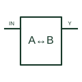

# Logic bus transceiver

Drives data between two digital buses according to the selected direction and enable conditions.

[Canonical reference](https://eloragrid.ai/symbols/logic-bus-transceiver) · [Structured record](../entries/logic-bus-transceiver.json) · [All references](README.md)

Updated: 2026-10-27. Drawing use: Schematic. Reference families: Manufacturer.

## What it represents

Drives data between two digital buses according to the selected direction and enable conditions.
On a schematic, identify the A/B bus domains, direction input and output-enable polarity and trace the active direction and high-impedance bus behaviour. Keep the component tag and signal/reference names consistent across the control drawing, terminal schedule and device documentation.
A transceiver supports a defined direction-control arrangement; it is not automatically a protocol controller or an isolator.
The preview is an independently drawn educational functional reference. Add the selected component’s actual power pins, terminal numbers, timing or analogue reference details when producing a construction drawing.

## How to read it

- Identify the A/B bus domains, direction input and output-enable polarity.
- Trace the active direction and high-impedance bus behaviour.

## Drawing checklist

- Label the A/B bus domains, direction input and output-enable polarity.
- Cross-reference the active direction and high-impedance bus behaviour.
- Add the selected device or circuit documentation revision, power/reference connections and project signal convention.

## Important distinction

A transceiver supports a defined direction-control arrangement; it is not automatically a protocol controller or an isolator.

## Facts

- Common schematic mnemonic: BUS-TR — descriptive only; project/device documentation defines reference designations.
- Terminal / interface focus: The A/B bus domains, direction input and output-enable polarity
- Artwork scope: Original educational functional/circuit reference; not a selected product pinout.

## Public references

- [SN74HC245 — bidirectional bus transceivers](https://www.ti.com/lit/ds/symlink/sn74hc245.pdf) — Texas Instruments. Public primary manufacturer documentation establishes the component function or circuit/topology relationship. Preview geometry and drafting explanations are independently authored.

## Related references

- [Three-state logic buffer](logic-three-state-buffer.md)
- [PLC input / output](plc-io.md)

Original educational concept geometry, CC BY 4.0. Unitless; not a certified standards glyph or manufacturer footprint.

Elora-authored explanations are CC BY 4.0. Linked standards and manufacturer material retain their own rights. Confirm project requirements using primary sources.
