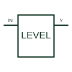

# Logic voltage-level translator

Transfers digital information between the documented logic-voltage domains.

[Canonical reference](https://eloragrid.ai/symbols/logic-voltage-level-translator) · [Structured record](../entries/logic-voltage-level-translator.json) · [All references](README.md)

Updated: 2026-10-27. Drawing use: Schematic. Reference families: Manufacturer.

## What it represents

Transfers digital information between the documented logic-voltage domains.
On a schematic, identify the two supplies, channel direction and power-sequencing requirements and trace the translated data and receiving-device interface. Keep the component tag and signal/reference names consistent across the control drawing, terminal schedule and device documentation.
Voltage translation changes logic-domain compatibility; it does not imply galvanic isolation or arbitrary input tolerance.
The preview is an independently drawn educational functional reference. Add the selected component’s actual power pins, terminal numbers, timing or analogue reference details when producing a construction drawing.

## How to read it

- Identify the two supplies, channel direction and power-sequencing requirements.
- Trace the translated data and receiving-device interface.

## Drawing checklist

- Label the two supplies, channel direction and power-sequencing requirements.
- Cross-reference the translated data and receiving-device interface.
- Add the selected device or circuit documentation revision, power/reference connections and project signal convention.

## Important distinction

Voltage translation changes logic-domain compatibility; it does not imply galvanic isolation or arbitrary input tolerance.

## Facts

- Common schematic mnemonic: LEVEL — descriptive only; project/device documentation defines reference designations.
- Terminal / interface focus: The two supplies, channel direction and power-sequencing requirements
- Artwork scope: Original educational functional/circuit reference; not a selected product pinout.

## Public references

- [SN74LVC1T45 — digital voltage-domain translation](https://www.ti.com/lit/ds/symlink/sn74lvc1t45.pdf) — Texas Instruments. Public primary manufacturer documentation establishes the component function or circuit/topology relationship. Preview geometry and drafting explanations are independently authored.

## Related references

- [Capacitive digital isolator](capacitive-digital-isolator.md)
- [PLC input / output](plc-io.md)

Original educational concept geometry, CC BY 4.0. Unitless; not a certified standards glyph or manufacturer footprint.

Elora-authored explanations are CC BY 4.0. Linked standards and manufacturer material retain their own rights. Confirm project requirements using primary sources.
