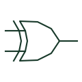

# Exclusive-OR gate

For two positive-logic inputs, produces a true output when the input states differ.

[Canonical reference](https://eloragrid.ai/symbols/logic-xor-gate) · [Structured record](../entries/logic-xor-gate.json) · [All references](README.md)

Updated: 2026-10-27. Drawing use: Schematic. Reference families: Manufacturer.

## What it represents

For two positive-logic inputs, produces a true output when the input states differ.
On a schematic, identify the two compared digital states and trace the inequality output and its control or monitoring use. Keep the component tag and signal/reference names consistent across the control drawing, terminal schedule and device documentation.
Two-input XOR is not inclusive OR; for more inputs verify whether the device implements odd parity or another specified function.
Terminal letters describe electrical roles, not package pin numbers. Check the selected public datasheet for the actual pin assignment, polarity and any internally connected terminals before completing the drawing.

## How to read it

- Identify the two compared digital states.
- Trace the inequality output and its control or monitoring use.

## Drawing checklist

- Label the two compared digital states.
- Cross-reference the inequality output and its control or monitoring use.
- Add the selected device or circuit documentation revision, power/reference connections and project signal convention.

## Important distinction

Two-input XOR is not inclusive OR; for more inputs verify whether the device implements odd parity or another specified function.

## Facts

- Common schematic mnemonic: XOR — descriptive only; project/device documentation defines reference designations.
- Terminal / interface focus: The two compared digital states
- Artwork scope: Original educational component glyph; not a certified standard graphic or package pinout.

## Public references

- [SN74HC86 — XOR gate logic](https://www.ti.com/lit/ds/symlink/sn74hc86.pdf) — Texas Instruments. Public primary manufacturer documentation establishes the component function or circuit/topology relationship. Preview geometry and drafting explanations are independently authored.

## Related references

- [Exclusive-NOR gate](logic-xnor-gate.md)
- [PLC input / output](plc-io.md)

Original educational concept geometry, CC BY 4.0. Unitless; not a certified standards glyph or manufacturer footprint.

Elora-authored explanations are CC BY 4.0. Linked standards and manufacturer material retain their own rights. Confirm project requirements using primary sources.
