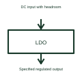

# Low-dropout voltage regulator

An LDO is a linear voltage regulator designed to operate with its specified small input-to-output voltage headroom.

[Canonical reference](https://eloragrid.ai/symbols/low-dropout-voltage-regulator) · [Structured record](../entries/low-dropout-voltage-regulator.json) · [All references](README.md)

Updated: 2026-10-27. Drawing use: Schematic. Reference families: Manufacturer.

## What it represents

An LDO is a linear voltage regulator designed to operate with its specified small input-to-output voltage headroom.
A circuit can use an LDO when the available supply is only moderately above the required output.
Use the same input/output distinction as for a linear regulator, but identify the required dropout conditions from the selected LDO. Low dropout describes its permitted voltage headroom, not zero loss or the ability to regulate from any input. Output-component and stability requirements remain device-specific. This is original functional artwork, not a certified standard graphic or device pinout.

## How to read it

- Identify input/output conditions and load current.
- Reference the specified dropout conditions.
- Follow the selected device’s output-component and thermal requirements.
- Low dropout does not mean zero loss or unrestricted operation below the required input voltage.

## Drawing checklist

- Identify input/output conditions and load current.
- Reference the specified dropout conditions.
- Follow the selected device’s output-component and thermal requirements.

## Important distinction

Low dropout does not mean zero loss or unrestricted operation below the required input voltage.

## Facts

- Representation type: Original functional block; not a certified IEC or IEEE graphic
- Concept input: DC input with headroom
- Concept output: Specified regulated output

## Public references

- [Linear voltage regulation](https://www.ti.com/product-category/power-management/linear-ldo-regulators/overview.html) — Texas Instruments. Linear voltage regulation: public technical context for the named function. Product and compliance details remain with the publisher.

## Related references

- [Series voltage reference](series-voltage-reference.md)
- [Linear voltage regulator](linear-voltage-regulator.md)
- [Power converter / inverter](power-converter.md)
- [Terminal connection](terminal.md)

Original educational concept geometry, CC BY 4.0. Unitless; not a certified standards glyph or manufacturer footprint.

Elora-authored explanations are CC BY 4.0. Linked standards and manufacturer material retain their own rights. Confirm project requirements using primary sources.
