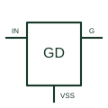

# Low-side gate driver

Provides gate-drive current for a power switch referenced to the driver's low-side return.

[Canonical reference](https://eloragrid.ai/symbols/low-side-gate-driver) · [Structured record](../entries/low-side-gate-driver.json) · [All references](README.md)

Updated: 2026-10-27. Drawing use: Schematic. Reference families: Manufacturer.

## What it represents

Provides gate-drive current for a power switch referenced to the driver's low-side return.
On a schematic, identify the command input, driver supply and source/emitter return and trace the gate resistor and controlled low-side power switch. Keep the component tag and signal/reference names consistent across the control drawing, terminal schedule and device documentation.
Low-side reference is an electrical node, not an automatic protective-earth connection.
The preview is an independently drawn educational functional reference. Add the selected component’s actual power pins, terminal numbers, timing or analogue reference details when producing a construction drawing.

## How to read it

- Identify the command input, driver supply and source/emitter return.
- Trace the gate resistor and controlled low-side power switch.

## Drawing checklist

- Label the command input, driver supply and source/emitter return.
- Cross-reference the gate resistor and controlled low-side power switch.
- Add the selected device or circuit documentation revision, power/reference connections and project signal convention.

## Important distinction

Low-side reference is an electrical node, not an automatic protective-earth connection.

## Facts

- Common schematic mnemonic: LS-GD — descriptive only; project/device documentation defines reference designations.
- Terminal / interface focus: The command input, driver supply and source/emitter return
- Artwork scope: Original educational functional/circuit reference; not a selected product pinout.

## Public references

- [UCC27524 — low-side gate-drive interfaces](https://www.ti.com/product/UCC27524) — Texas Instruments. Public primary manufacturer documentation establishes the component function or circuit/topology relationship. Preview geometry and drafting explanations are independently authored.

## Related references

- [N-channel enhancement MOSFET](n-channel-enhancement-mosfet.md)
- [Diode](diode.md)

Original educational concept geometry, CC BY 4.0. Unitless; not a certified standards glyph or manufacturer footprint.

Elora-authored explanations are CC BY 4.0. Linked standards and manufacturer material retain their own rights. Confirm project requirements using primary sources.
