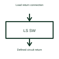

# Low-side power switch

A low-side switch controls the return-side connection of a load in its specified circuit.

[Canonical reference](https://eloragrid.ai/symbols/low-side-power-switch) · [Structured record](../entries/low-side-power-switch.json) · [All references](README.md)

Updated: 2026-10-27. Drawing use: Schematic. Reference families: Manufacturer.

## What it represents

A low-side switch controls the return-side connection of a load in its specified circuit.
A load can remain connected to its supply while its return path is switched by a suitable device.
Place the switch between the load and its defined return reference. The load may remain connected to the supply even while this switch is open. Show the complete current loop so a reader does not mistake return-path switching for disconnection of every supply conductor. This is original functional artwork, not a certified standard graphic or device pinout.

## How to read it

- Identify the load’s permanent supply connection.
- Show the switched return path and reference.
- Reference control-drive and load-transient requirements.
- Low-side switching does not necessarily isolate the load from the supply conductor.

## Drawing checklist

- Identify the load’s permanent supply connection.
- Show the switched return path and reference.
- Reference control-drive and load-transient requirements.

## Important distinction

Low-side switching does not necessarily isolate the load from the supply conductor.

## Facts

- Representation type: Original functional block; not a certified IEC or IEEE graphic
- Concept input: Load return connection
- Concept output: Defined circuit return

## Public references

- [Low-side power switching](https://www.ti.com/product-category/power-management/low-side-switches/overview.html) — Texas Instruments. Low-side power switching: public technical context for the named function. Product and compliance details remain with the publisher.

## Related references

- [Low-side gate driver](low-side-gate-driver.md)
- [Power converter / inverter](power-converter.md)
- [Terminal connection](terminal.md)

Original educational concept geometry, CC BY 4.0. Unitless; not a certified standards glyph or manufacturer footprint.

Elora-authored explanations are CC BY 4.0. Linked standards and manufacturer material retain their own rights. Confirm project requirements using primary sources.
