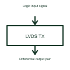

# LVDS line driver

An LVDS driver converts a logic signal into the selected low-voltage differential output.

[Canonical reference](https://eloragrid.ai/symbols/lvds-line-driver) · [Structured record](../entries/lvds-line-driver.json) · [All references](README.md)

Updated: 2026-10-27. Drawing use: Schematic. Reference families: Manufacturer.

## What it represents

An LVDS driver converts a logic signal into the selected low-voltage differential output.
A board can send data over an appropriately designed differential connection to a matching receiver.
Show the logic input and the two differential output conductors. A driver creates the signal that a compatible receiver interprets; the differential pair is not a power supply or an unspecified pair of ordinary digital outputs. Identify the selected link and termination requirements. This is original functional artwork, not a certified standard graphic or device pinout.

## How to read it

- Identify the driver input and differential pair labels.
- Reference the supported receiver and termination.
- Show the selected supply and signal-return arrangement.
- A differential signal pair needs its specified termination and routing; two wires alone do not define a valid interface.

## Drawing checklist

- Identify the driver input and differential pair labels.
- Reference the supported receiver and termination.
- Show the selected supply and signal-return arrangement.

## Important distinction

A differential signal pair needs its specified termination and routing; two wires alone do not define a valid interface.

## Facts

- Representation type: Original functional block; not a certified IEC or IEEE graphic
- Concept input: Logic input signal
- Concept output: Differential output pair

## Public references

- [Low-voltage differential signalling](https://www.ti.com/product-category/interface/lvds-m-lvds-pecl-ics/overview.html) — Texas Instruments. Low-voltage differential signalling: public technical context for the named function. Product and compliance details remain with the publisher.

## Related references

- [Logic bus transceiver](logic-bus-transceiver.md)
- [LVDS line receiver](lvds-line-receiver.md)
- [Power converter / inverter](power-converter.md)
- [Terminal connection](terminal.md)

Original educational concept geometry, CC BY 4.0. Unitless; not a certified standards glyph or manufacturer footprint.

Elora-authored explanations are CC BY 4.0. Linked standards and manufacturer material retain their own rights. Confirm project requirements using primary sources.
