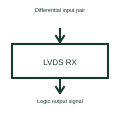

# LVDS line receiver

An LVDS receiver converts a compatible differential input into its specified logic output.

[Canonical reference](https://eloragrid.ai/symbols/lvds-line-receiver) · [Structured record](../entries/lvds-line-receiver.json) · [All references](README.md)

Updated: 2026-10-27. Drawing use: Schematic. Reference families: Manufacturer.

## What it represents

An LVDS receiver converts a compatible differential input into its specified logic output.
The receiving end of a link can recover the logic state from the differential pair.
Identify the differential input pair and the receiver’s logic output. The pair’s valid input conditions and the output’s logic levels are separate specifications. Keep the sender and receiver labels visible so the drawing describes a complete direction of information flow. This is original functional artwork, not a certified standard graphic or device pinout.

## How to read it

- Label the differential input pair consistently with the driver.
- Reference accepted input conditions and termination.
- Identify the output logic supply and destination.
- A receiver's accepted input conditions and output logic levels are separate specifications.

## Drawing checklist

- Label the differential input pair consistently with the driver.
- Reference accepted input conditions and termination.
- Identify the output logic supply and destination.

## Important distinction

A receiver's accepted input conditions and output logic levels are separate specifications.

## Facts

- Representation type: Original functional block; not a certified IEC or IEEE graphic
- Concept input: Differential input pair
- Concept output: Logic output signal

## Public references

- [Low-voltage differential signalling](https://www.ti.com/product-category/interface/lvds-m-lvds-pecl-ics/overview.html) — Texas Instruments. Low-voltage differential signalling: public technical context for the named function. Product and compliance details remain with the publisher.

## Related references

- [Logic bus transceiver](logic-bus-transceiver.md)
- [LVDS line driver](lvds-line-driver.md)
- [Power converter / inverter](power-converter.md)
- [Terminal connection](terminal.md)

Original educational concept geometry, CC BY 4.0. Unitless; not a certified standards glyph or manufacturer footprint.

Elora-authored explanations are CC BY 4.0. Linked standards and manufacturer material retain their own rights. Confirm project requirements using primary sources.
