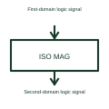

# Magnetic digital isolator

A magnetic digital isolator transfers digital information across its isolation barrier using magnetic coupling.

[Canonical reference](https://eloragrid.ai/symbols/magnetic-digital-isolator) · [Structured record](../entries/magnetic-digital-isolator.json) · [All references](README.md)

Updated: 2026-10-27. Drawing use: Schematic. Reference families: Manufacturer.

## What it represents

A magnetic digital isolator transfers digital information across its isolation barrier using magnetic coupling.
The two sides of a control interface can exchange logic information while retaining their specified electrical separation.
Draw two electrical domains with a barrier between them and identify the signal direction. Magnetic coupling transfers information without a direct conducting signal path across that barrier. Power for each side and the device’s insulation requirements must still be represented separately. This is original functional artwork, not a certified standard graphic or device pinout.

## How to read it

- Identify both supply/reference domains.
- Show each signal’s direction across the barrier.
- Reference the selected isolator’s working-voltage and insulation data.
- The coupling method does not itself establish the device's working voltage or certification.

## Drawing checklist

- Identify both supply/reference domains.
- Show each signal’s direction across the barrier.
- Reference the selected isolator’s working-voltage and insulation data.

## Important distinction

The coupling method does not itself establish the device's working voltage or certification.

## Facts

- Representation type: Original functional block; not a certified IEC or IEEE graphic
- Concept input: First-domain logic signal
- Concept output: Second-domain logic signal

## Public references

- [Transformer-coupled digital isolation example](https://www.analog.com/en/products/adum1100.html) — Analog Devices. Primary-source technical context for this particular function; product-specific ratings remain with the manufacturer.

## Related references

- [Capacitive digital isolator](capacitive-digital-isolator.md)
- [Isolated comparator](isolated-comparator.md)
- [Power converter / inverter](power-converter.md)
- [Terminal connection](terminal.md)

Original educational concept geometry, CC BY 4.0. Unitless; not a certified standards glyph or manufacturer footprint.

Elora-authored explanations are CC BY 4.0. Linked standards and manufacturer material retain their own rights. Confirm project requirements using primary sources.
