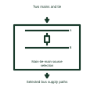

# Main-tie-main source selection

Identifies the supply paths and control interfaces of a main-tie-main lineup.

[Canonical reference](https://eloragrid.ai/symbols/main-tie-main-source-selection) · [Structured record](../entries/main-tie-main-source-selection.json) · [All references](README.md)

Updated: 2026-11-03. Drawing use: Schematic. Reference families: Manufacturer.

Representation: functional-block; installation focus: switchgear.
Two mains and tie
Selected bus supply paths

## What it represents

Identifies the supply paths and control interfaces of a main-tie-main lineup. A source and bus arrangement shows how incoming supplies and outgoing circuits can be connected. Breaker and tie positions determine which sections are energized and whether sources can become electrically paralleled.
In a switchgear lineup with two incomers and a bus tie, the single-line arrangement helps the engineer identify normal supply paths and which loads change source during a transfer. For this reference, the drawing identifies “Two mains and tie” at the input and “Selected bus supply paths” at the output. The name alone does not define the control sequence.
Keep normal positions, transfer limits, source independence and protection-zone boundaries visible. An arrangement drawing explains connectivity; the permitted switching sequence needs a separate approved scheme. The functional block is an independent explanation of this named application. Equipment-specific ratings, terminal connections and operating conditions must be established in the project documentation.

## How to read it

- Start at the named input: Two mains and tie. Identify its source device or document and the state represented on the drawing.
- Follow the named output: Selected bus supply paths. Cross-reference its destination and separate the command from confirmation that the equipment responded.
- The name alone does not define the control sequence.
- Keep normal positions, transfer limits, source independence and protection-zone boundaries visible. An arrangement drawing explains connectivity; the permitted switching sequence needs a separate approved scheme.

## Drawing checklist

- Label the source and connection reference for two mains and tie.
- Identify the destination and defined state of selected bus supply paths.
- Record the equipment or control-document revision supporting this functional block.
- Check this application limit in the project design: The name alone does not define the control sequence.

## Important distinction

The name alone does not define the control sequence. This reference describes the named application; it does not establish a new IEC graphical symbol, an ANSI device-function number or an exact manufacturer connection diagram.

## Facts

- Representation: Functional block
- Installation focus: Switchgear
- Input / boundary: Two mains and tie
- Output / connection: Selected bus supply paths
- Lookup label: MSS is a library lookup label, not a standard device designation.

## Public references

- [SEL-451 protection, automation and bay control](https://selinc.com/products/451/) — SEL. Public technical context for switchboard source and bus interfaces. Bus arrangements, breaker control and bay-level coordination. The application text and educational graphic are independently authored; the publisher does not certify this representation.

## Related references

- [Busbar](busbar.md)
- [Automatic transfer switch](automatic-transfer-switch.md)
- [Generator incomer connection interface](generator-incomer-connection-interface.md)

Original educational concept geometry, CC BY 4.0. Unitless; not a certified standards glyph or manufacturer footprint.

Elora-authored explanations are CC BY 4.0. Linked standards and manufacturer material retain their own rights. Confirm project requirements using primary sources.
