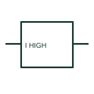

# Maximum-current monitoring relay

A maximum-current relay changes its output when the measured current meets a configured high-current condition.

[Canonical reference](https://eloragrid.ai/symbols/maximum-current-monitoring-relay) · [Structured record](../entries/maximum-current-monitoring-relay.json) · [All references](README.md)

Updated: 2026-10-27. Drawing use: SLD, Schematic. Reference families: Manufacturer.

## What it represents

A maximum-current relay changes its output when the measured current meets a configured high-current condition. Its schematic separates measurement, auxiliary power and relay outputs.

## How to read it

- Determine whether the input is direct current, a CT secondary or a conditioned signal.
- The preview is an original explanation of this function. Match the actual drawing convention to its legend and the selected equipment documentation.

## Drawing checklist

- Identify measured input
- Reference threshold and delay
- Show output destination

## Important distinction

A maximum-current monitoring element is not a complete feeder protection scheme by itself.

## Facts

- Drawing role: Monitoring element
- Representation scope: Functional concept; not an official standard graphic or a product footprint
- Public vendor block reference: HCR1F25, VCR1F25 (Autodesk identifiers; not IEC symbol numbers)
- Identifier status: The short label is a functional lookup label, not an assigned IEC or IEEE symbol number. Any separately listed Autodesk code is a verified vendor block name.

## Public references

- [AutoCAD Electrical: Current monitoring relays](https://help.autodesk.com/cloudhelp/2021/ENU/AutoCAD-Electrical/files/GUID-E0DDA638-4664-4F1E-B191-29A4C40C4A0A.htm) — Autodesk. Public documentation of this equipment function or named vendor variant; the illustration is independently authored and is not the source graphic.

## Related references

- [Current transformer](current-transformer.md)
- [Relay coil](relay-coil.md)

Original educational concept geometry, CC BY 4.0. Unitless; not a certified standards glyph or manufacturer footprint.

Elora-authored explanations are CC BY 4.0. Linked standards and manufacturer material retain their own rights. Confirm project requirements using primary sources.
